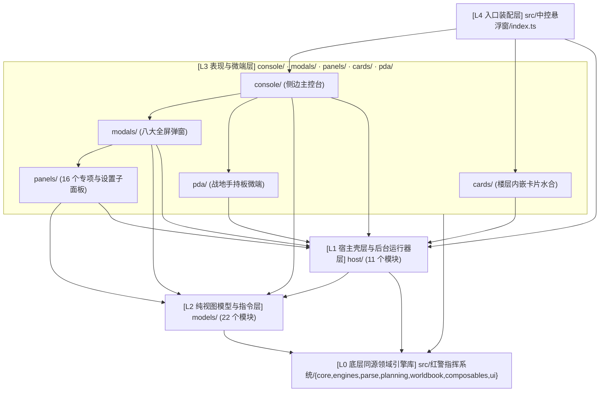
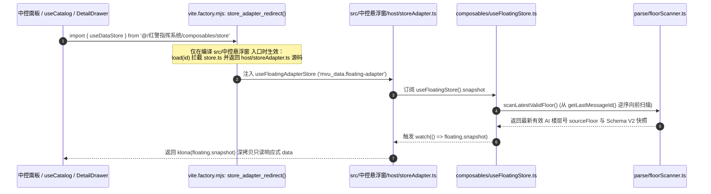

# 00 · 架构总览与目录分层规范（`src/中控悬浮窗` 核心架构与双端同源拓扑）

> **核心描述对象**：`mvu指挥系统/src/中控悬浮窗`（战术中控悬浮窗全局脚本工程，`RAC-ENTRY-01`）及其与底层同源领域引擎库 `mvu指挥系统/src/红警指挥系统` 的跨工程协同架构。
> **关联构建与入口文件**：`mvu指挥系统/src/中控悬浮窗/index.ts`、`mvu指挥系统/src/中控悬浮窗/host/storeAdapter.ts`、`mvu指挥系统/vite.factory.mjs`、`mvu指挥系统/webpack.config.ts`。

---

## 1. 架构定位：以 `src/中控悬浮窗` 为核心的双端同源体系

在 SillyTavern 宿主环境中，红警指挥系统采用 **「常驻全局脚本中控台（`src/中控悬浮窗`）+ 同源领域引擎底座（`src/红警指挥系统`）+ 瘦身楼层状态栏 + 开局向导（`src/开场启动器`）」** 的双端同源架构：

- **第一核心交互与调度宿主：`mvu指挥系统/src/中控悬浮窗`**
  作为角色卡绑定的 Tavern Helper 全局脚本（编译产物 `dist/中控悬浮窗/index.js`，无 `index.html`），它在整个聊天会话生命周期内常驻于独立的 `TH-script--*` iframe 中。它不仅承载了红警经典侧边主控台（`console/`）、八大全屏战术弹窗（`modals/`）、16 个功能与设置子面板（`panels/`）、聊天楼层内嵌卡片水合器（`cards/`）和战地手持板微端（`pda/`），而且通过 `host/` 层独家接管了全系统的楼层事件监听、解析触发、前馈注入与自动入档。
- **底层同源领域引擎库：`mvu指挥系统/src/红警指挥系统`**
  提供与 UI 宿主解耦的 7 大领域子目录（`core/`、`engines/`、`parse/`、`planning/`、`worldbook/`、`composables/`、`ui/`）。其中前 6 层为纯 TypeScript 领域模型、确定性推进引擎、L0-L3 解析管线、参谋沙盒、世界书持久化网关与 Pinia 响应式 Store，被 `src/中控悬浮窗` 直接通过模块路径导入复用；其自身的 `index.html` + `ui/App.vue` 则退化为纯粹的楼层内嵌只读状态栏（受 `CTRL-FLOOR-SLIM-01` 契约约束）。

---

## 2. `mvu指挥系统/src/中控悬浮窗` 完整 7 层物理目录拓扑

重构与千行大文件拆分完成后，`mvu指挥系统/src/中控悬浮窗` 由 **根目录唯一入口 `index.ts`** 与 **7 大领域子目录（`host/`、`models/`、`console/`、`modals/`、`panels/`、`cards/`、`pda/`，共 88 个源码模块）** 构成：

```text
mvu指挥系统/src/中控悬浮窗/
├── index.ts                             # [Root] 全局脚本唯一入口：挂载 shell/FloatingApp，安装观察者/水合器/四路 Runner，pagehide 逆序卸载
├── host/                                # [L1 宿主与桥接层] 壳层几何、跨文档弹窗宿主、Store 适配、楼层观察者与后台 Runner（11 个模块）
│   ├── shell.ts                         #   悬浮窗 DOM 宿主壳层：iframe 可见化、拖拽/停靠（right/left/free）、窄屏钳位与 localStorage 持久化
│   ├── modalHost.ts                     #   全屏弹窗 Teleport 宿主管理：挂载至 hostDocument.body、样式克隆、主题变量同步与 Z-Index 栈治理
│   ├── modalErrorGuard.ts               #   模态框子树 onErrorCaptured 异常捕获守卫：渲染崩溃时自动回退弹窗态释放全屏遮罩
│   ├── storeAdapter.ts                  #   构建期 store_adapter_redirect 注入的只读 Store 替身（mvu_data.floating-adapter）
│   ├── floorObservers.ts                #   酒馆楼层事件唯一观察者：GENERATION_ENDED/SWIPED/EDITED/CHAT_CHANGED 串行驱动 runParseFor 与 refresh
│   ├── floorVarWrite.ts                 #   中控台受控楼层变量写回唯一通道（updateFloorVars，供白名单设置/补丁/入档/归档调用）
│   ├── advisoryRunner.ts                #   科研参谋建议后台运行器（GENERATION_STARTED 令牌 + GENERATION_AFTER_COMMANDS 动态 Prompt 注入）
│   ├── scheduleRunner.ts                #   《当前工程日程》后台运行器（同构四路清理 + 到期/排程前馈 Prompt 注入）
│   ├── expansionAutoFiler.ts            #   <扩展档案> 自动入档聊天世界书后台运行器与状态管理
│   ├── girlAutoFiler.ts                 #   <机娘档案> 自动入档双世界书后台运行器与状态管理
│   └── worldbookReader.ts               #   中控台世界书只读读取器（按书名记忆化缓存 + 随 useFloatingStore.onRefresh 自动失效）
├── models/                              # [L2 视图模型与指令层] 纯函数视图投影、世界书目录解析、指令构造与审计补丁模型（22 个模块）
│   ├── worldbookCatalogParser.ts        #   世界书条目（【科技】【建筑】【生产】【协议】等）解析为 Catalog 与单位增强字典的主解析器
│   ├── worldbookCatalogHelpers.ts       #   世界书条目名清洗、量产后缀剥离、键值块提取与数值容错解析辅助模块
│   ├── buildingSystemModel.ts           #   基地建筑五大体系（指挥/发电/采矿/防卫/农业）SVG 拓扑图与集群聚合主模型
│   ├── buildingSystemHelpers.ts         #   建筑体系分类判定、双模建筑识别、防御环（内环/中环/外环）与生态阶段辅助计算
│   ├── armoryPanelModel.ts              #   军械库与机娘编成视图主模型（在编机娘/人员编制/载具集群/待审档案合并投影）
│   ├── armoryPanelHelpers.ts            #   机娘花名册/能力卡/剧情卡字段归一化、战力统计与作用域过滤辅助模块
│   ├── schedulePanelModel.ts            #   工程日程面板同源投影模型（基地产线、11 科研槽、V1/V2 巨构工程、战略协议轨道与甘特态）
│   ├── resourcePanelModel.ts            #   全局六大战略资源柱（资金/电力/矿石/算力/纳米/太空）与日净现金流视图模型
│   ├── queueDisplayModel.ts             #   队列条目剩余工期、进度百分比与色调语义格式化模型
│   ├── operationEngine.ts               #   中控台战术行动视图计算模型（基地环境事实、建筑额定输入输出、Buff 触发汇总与工况评估）
│   ├── engCommands.ts                   #   工程车间指令生成模型（立项/注资/暂缓/恢复/撤项报文构造与撤项退款核算）
│   ├── engScene.ts                      #   工程车间 SVG 装配场景视图模型（热区状态映射、分期切片、V2 仓段切片与默认视口）
│   ├── engSceneAsset.ts                 #   工程车间世界书 SVG 场景资产按需加载与兜底解析器
│   ├── protocolCommands.ts              #   三阶协议院所指令生成模型（实验前置门禁、自动排程指令、撤回指令与暂存回执视图）
│   ├── dispatchOrderText.ts             #   队列四动词（置顶/置底/暂缓/恢复）调度令自然语言报文生成与按钮启用矩阵
│   ├── archiveIndex.ts                  #   世界书与设定图鉴档案索引构建器（按科技/建筑/载具/人员/装备/机娘/剧情分组与检索）
│   ├── useArchiveIndex.ts               #   图鉴档案索引响应式 Composable（绑定 useFloatingStore.onRefresh 自动失效重拉）
│   ├── expansionView.ts                 #   扩展档案前缀识别、聊天世界书词条分组与私产提升建议模型
│   ├── tagTaxonomy.ts                   #   10 大主领域 + 11 大战术特征标签体系与六大建造面板分组（BUILD_PANEL_GROUPS / PRODUCTION_SUBS）
│   ├── auditViewModel.ts                #   R20 生产对账裁决（绿/黄/红）过滤视角与统计摘要视图模型
│   ├── patchDiff.ts                     #   <数据更新> 动态补丁与当前有效目录的字段级 Diff 预览计算模型
│   └── patchFailFingerprint.ts          #   动态补丁失败指纹生成、重试抑制桶与跨分支指纹克隆模型
├── console/                             # [L3 侧边主控台层] 红警经典右侧停靠主控台 UI 组件群（10 个模块）
│   ├── FloatingApp.vue                  #   中控台根组件：装配侧边主控台六大区、托管八大弹窗/PDA 宿主与只读安全守卫
│   ├── ConsoleTopNav.vue                #   主控台顶栏：当前基准楼层号、手动刷新、图鉴入口、设置入口与 PDA 召回开关
│   ├── ConsoleRadarScreen.vue           #   基地雷达监视屏：动态阵营徽标扫描动效、当前基地概览与多基地切换下拉框
│   ├── ConsolePowerBar.vue              #   左侧竖向能量柱：总发电/总耗电比值刻度、净余电力与 LOW 低电红闪告警
│   ├── ConsoleBuildGrid.vue             #   核心建造网格：六大基建页签、二级生产子栏、标签过滤、双三角翻页与一键展开 MCV
│   ├── consoleBuildGridHelpers.ts       #   建造网格候选条目聚合、前置门禁着色、在建/在研数量角标与点击指令派发辅助模块
│   ├── ConsoleQuickActions.vue          #   底部快捷动作三宫格：科技 TECH（含协议可实验徽标）、机娘 MECHA、工程车间/日程入口
│   ├── ConsoleDockHandle.vue            #   侧边吸附折叠把手：展开/收起切换、拖拽手柄与运行状态 LED 指示灯
│   ├── ChronoMismatchBanner.vue         #   超时空分支/楼层快照失步警示横幅：检测 $timeline 与当前楼层偏差并提供一键修复
│   └── TagFilterBar.vue                 #   多维战术标签检索胶囊栏（消费 tagTaxonomy.ts）
├── modals/                              # [L4 全屏战术弹窗层] Teleport 至宿主全视窗的八大模态容器（10 个模块）
│   ├── ModalEngineering.vue             #   工程车间全屏弹窗：短期技改、V1 分期工程、V2 仓段巨构工程与太空发射合同综合工作台
│   ├── modalEngineeringHelpers.ts       #   工程车间立项候选过滤、V2 仓段槽位指派交互与太空合同发射准备辅助模块
│   ├── ModalBuildings.vue               #   基地建筑与五大体系 SVG 拓扑总览弹窗（含双模切换、建筑启停与防守环视图）
│   ├── modalBuildingsHelpers.ts         #   建筑拓扑节点坐标布局、连线渲染与实例详情映射辅助模块
│   ├── ModalSchedule.vue                #   工程日程与全局队列四动词（置顶/置底/暂缓/恢复）调度弹窗
│   ├── ModalMechaGirl.vue               #   机娘编成、能力/剧情双卡查阅与军械库战力总览弹窗
│   ├── ModalTechTree.vue                #   科技研发树与苏/盟三阶协议院所双生主厅弹窗（TechModalHall 切换）
│   ├── ModalResources.vue               #   全局经济、六大资源柱、资金链明细、电力与科研算力详情弹窗
│   ├── ModalArchive.vue                 #   世界书与设定图鉴查阅弹窗
│   └── ModalSettings.vue                #   中控台综合设置弹窗（装配 SettingsShell 与 panels/ 下各治理子面板）
├── panels/                              # [L4 功能子面板层] 嵌入弹窗的专项业务面板与设置子页（16 个模块）
│   ├── PanelProtocol.vue                #   苏/盟三阶协议院所主面板（T1~T3 动态院所头衔、全局算力并网栏、协议树与实验指令）
│   ├── panelProtocolHelpers.ts          #   协议院所阵营主题、轨道分组、概率进度条与实验回执格式化辅助模块
│   ├── EngSceneView.vue                 #   工程车间交互式 SVG 装配场景渲染面板（热区高亮与仓段点击交互）
│   ├── SettingsShell.vue                #   设置弹窗左栏分组导航与右侧内容插槽壳层
│   ├── PanelParseRepair.vue             #   战报解析诊断、R20 对账视角、手动补丁修正与强制重解析面板
│   ├── PanelAliasDict.vue               #   实体自定义别名词典（$aliases）增删管理面板
│   ├── PanelWorldbookToggle.vue         #   多世界与阵营世界书总开关控制面板
│   ├── PanelDlcManager.vue              #   DLC 扩展包预检（R1-R12）、事务安装/卸载回滚与万能导入面板
│   ├── PanelDataPatches.vue             #   <数据更新> 动态补丁三通道审核门（Diff 预览、批准应用、驳回拉黑）面板
│   ├── PanelExpansionFiling.vue         #   <扩展档案> 待审队列预览、手动/自动入书与聊天私产提升至全局书面板
│   ├── PanelGirlFiling.vue              #   <机娘档案> 待审队列预览与双世界书一键入档面板
│   ├── PanelArchive.vue                 #   动态世界书归档管理与 DLC 孤儿词条恢复面板
│   ├── PanelExportSave.vue              #   当前完整战局快照与设置导出面板
│   ├── PanelIntegrityCheck.vue          #   R1-R27 三维环境、变量对账与世界书语法体检及私产提升审计面板
│   ├── PanelPlanningCard.vue            #   参谋排产规划卡（Option A/B 沙盒预演对比与一键批准提交）面板
│   └── PanelBuildings.vue               #   基地建筑分类列表与工况详情子面板
├── cards/                               # [L3 同层卡片水合层] 聊天楼层内嵌卡片水合器与 Vue 卡片组件（7 个模块）
│   ├── floorCardHydrator.ts             #   楼层卡片水合主控制器：扫描宿主 .tw-floor-card-host 并绑定 MutationObserver 增量水合
│   ├── floorCardParsers.ts              #   四类楼层卡片原始载荷 YAML/键值解析器与 CSS 颜色白名单消毒器
│   ├── floorCardMounts.ts               #   将解析后的卡片数据挂载为同源 iframe / 宿主 DOM 节点的渲染装配器
│   ├── FactionUnlockCard.vue            #   <阵营解锁> 战区启封卷宗卡片组件
│   ├── MaidenDossierCard.vue            #   <机娘档案> 角色立绘与四维能力入列卷宗卡片组件
│   ├── MaidenStatusCard.vue             #   <机娘状态> 好感/服从/堕落/心情动态状态卡片组件
│   └── SpaceContractCard.vue            #   <太空合同> 轨道发射载荷与窗口交互卡片组件
└── pda/                                 # [L3 战地手持板微端层] 独立于主控台的 Tactical PDA 悬浮微端（11 个模块）
    ├── pdaState.ts                      #   PDA 展开/收起、左右贴边吸附、自由拖拽几何与页签状态机（localStorage 持久化）
    ├── notificationQueue.ts             #   楼层事件通知队列构建器、严重度分级（alert/warn/info）与楼层回退裁剪器
    ├── TacticalPdaHost.vue              #   PDA 顶层宿主组件（Teleport 至宿主 HUD 层 z-index: 9995）
    ├── PdaWindowFrame.vue               #   PDA 战术视窗外框、顶部拖拽栏、四页签切换栏与底部操作区
    ├── PdaBeaconButton.vue              #   PDA 收起态贴边唤醒信标按钮与未读角标动效
    ├── PdaNotificationPill.vue          #   单条战地通知胶囊组件（支持点击跳转对应 PDA 页签）
    ├── PdaFanoutStack.vue               #   多条未读战地通知扇出堆叠容器
    ├── PdaTabEvents.vue                 #   PDA「战地事件」页签（按紧急/重要/一般过滤当前与历史事件）
    ├── PdaTabChains.vue                 #   PDA「资金链」页签（监控五态现金流链路、电网/天候折损与抢修动作）
    ├── PdaTabIntel.vue                  #   PDA「待审情报」页签（预览 pending_lore 设定词条并执行确认入书或驳回）
    └── PdaTabQuests.vue                 #   PDA「作战任务」页签（主线/支线任务目标进度与奖励查阅）
```

---

## 3. 分层职责与单向依赖规范

### 3.1 `src/中控悬浮窗` 内部四级分层与单向依赖准则

`src/中控悬浮窗` 内部严格划分为 4 个逻辑层级，遵循**自上而下或由表现层向模型/宿主层单向依赖**的准则：



1. **禁止 `models/` 反向依赖任何 Vue 组件层（`console/`、`modals/`、`panels/`、`cards/`、`pda/`）**：
   `models/` 下的 22 个模块（除 `useArchiveIndex.ts` 封装了 `host/worldbookReader.ts` 的响应式缓存失效外）全部为无 DOM 副作用的纯函数模型，可在 Node.js 环境下直接进行确定性单元测试。
2. **模态框与子面板的单向包含关系（`console/FloatingApp.vue` → `modals/` → `panels/`）**：
   - `FloatingApp.vue` 统一挂载 `modals/` 下的八大全屏弹窗与 `pda/TacticalPdaHost.vue`；
   - `modals/` 负责全屏弹窗容器布局、顶栏切换与跨面板状态协调，向下装配 `panels/`（例如 `ModalTechTree.vue` 装配 `PanelProtocol.vue`，`ModalEngineering.vue` 装配 `EngSceneView.vue`，`ModalSchedule.vue` 装配 `PanelPlanningCard.vue`，`ModalSettings.vue` 通过 `SettingsShell.vue` 装配 11 个设置子面板）；
   - `panels/` 绝不反向导入 `modals/` 或 `console/`。
3. **宿主写入与跨文档 DOM 访问收口于 `host/`**：
   - 任何需要跨越脚本 iframe 访问酒馆主文档（`window.parent.document`）的操作，统一经 `host/modalHost.ts`（`getHostDocument`、`ensureModalHost`、`ensureHudHost`）或 `host/shell.ts` 完成；
   - 任何需要从 UI 面板写回楼层变量的操作，统一经 `host/floorVarWrite.ts`（`updateFloorVars`）完成。

### 3.2 实测模块导入矩阵（`src/中控悬浮窗` 内部 & 跨工程调用 `src/红警指挥系统`）

通过静态 AST 扫描 `src/中控悬浮窗` 全部源码，其实测跨子目录导入频次矩阵如下：

| 调用方（`src/中控悬浮窗`） \ 被调用方 | 内部:`host/` | 内部:`models/` | 内部:`panels/` | 内部:`modals/` | 内部:`pda/` | 底层:`core/` | 底层:`engines/` | 底层:`parse/` | 底层:`planning/` | 底层:`worldbook/` | 底层:`composables/` | 底层:`ui/` |
|---|---:|---:|---:|---:|---:|---:|---:|---:|---:|---:|---:|---:|
| **`index.ts` (Root)** | 6 | 0 | 0 | 0 | 0 | 0 | 0 | 0 | 0 | 1 | 1 | 2(css) |
| **`host/`** | — | 3 | 0 | 0 | 0 | 7 | 0 | 4 | 3 | 7 | 7 | 0 |
| **`models/`** | 1 | — | 0 | 0 | 0 | 22 | 14 | 4 | 4 | 4 | 3 | 0 |
| **`console/`** | 4 | 6 | 1 | 8 | 2 | 10 | 3 | 2 | 1 | 1 | 10 | 7 |
| **`modals/`** | 3 | 12 | 15 | — | 0 | 9 | 5 | 0 | 1 | 5 | 11 | 11 |
| **`panels/`** | 5 | 8 | — | 0 | 0 | 8 | 5 | 10 | 0 | 6 | 27 | 11 |
| **`cards/`** | 1 | 0 | 0 | 0 | 0 | 0 | 0 | 0 | 0 | 0 | 0 | 0 |
| **`pda/`** | 2 | 0 | 0 | 0 | — | 6 | 1 | 0 | 0 | 4 | 5 | 1 |

---

## 4. 跨 iframe 安全边界：`in_script_iframe` 与 `store_adapter_redirect`

### 4.1 为什么全局脚本 iframe 是高危隔离区？

在 SillyTavern + Tavern Helper 运行时中，存在两类截然不同的 iframe 宿主环境：

| 维度 | 楼层状态栏 iframe（`src/红警指挥系统`） | 全局脚本 iframe（`src/中控悬浮窗`） |
|---|---|---|
| **宿主容器 ID** | 嵌入单条聊天消息内的消息楼层 iframe | Tavern Helper 挂载在 `body` 下的 `TH-script--*` 隐藏 iframe |
| **`getCurrentMessageId()` 行为** | 正常返回当前消息楼层号（如 `12`） | **直接抛出异常**（全局脚本不属于任何单条消息楼层） |
| **默认可见性与尺寸** | 随所在聊天楼层滚动，高度自适应 | 默认 `display: none`；由 `host/shell.ts` 改为 `position: fixed` 侧边停靠（展开 `400×640`，收起 `288×40`） |
| **模态框渲染空间** | 受限于楼层 iframe 视口 | 侧边栏尺寸固定；全屏模态框通过 `host/modalHost.ts` Teleport 到 `window.parent.document.body` 的全视窗覆盖层 iframe（`z-index: 10000+`） |

### 4.2 `store_adapter_redirect` 构建期透明桥接机制（`D-RAC-ENTRY-STORE-01`）

由于 `src/中控悬浮窗` 大量复用了 `src/红警指挥系统/composables/`（如 `useCatalog.ts`）与 `ui/` 组件，而这些模块内部均包含 `import { useDataStore, in_tavern } from './store'`：
- 如果在 `src/中控悬浮窗` 中直接加载原始的 `src/红警指挥系统/composables/store.ts`，其顶层执行的 `getCurrentMessageId()` 会在脚本启动瞬间使整个中控悬浮窗崩溃，且其内置的 2s 轮询与 `updateVariablesWith` 会造成不可控的跨楼写冲突。
- 为此，`mvu指挥系统/vite.factory.mjs`（第 244～263 行）与 `webpack.config.ts` 实现了专用于 `src/中控悬浮窗` 入口的编译期钩子 **`store_adapter_redirect()`**：



- **零崩溃**：`useFloatingStore` 完全不调用 `getCurrentMessageId()`，而是通过 `getLastMessageId()` 配合 `scanLatestValidFloor` 逆序扫描最近一个包含合法 `stat_data` 的 AI 楼层。
- **零污染**：`host/storeAdapter.ts` 提供给所有组件的 `data` 是 `klona(floating.snapshot)` 的深拷贝副本；即使复用的组件在本地修改了 `data` 属性，也仅影响当前内存视图，绝不会触发 `updateVariablesWith` 写回宿主，并在下一次 `floatingStore.refresh()` 时被最新权威快照整体替换。
