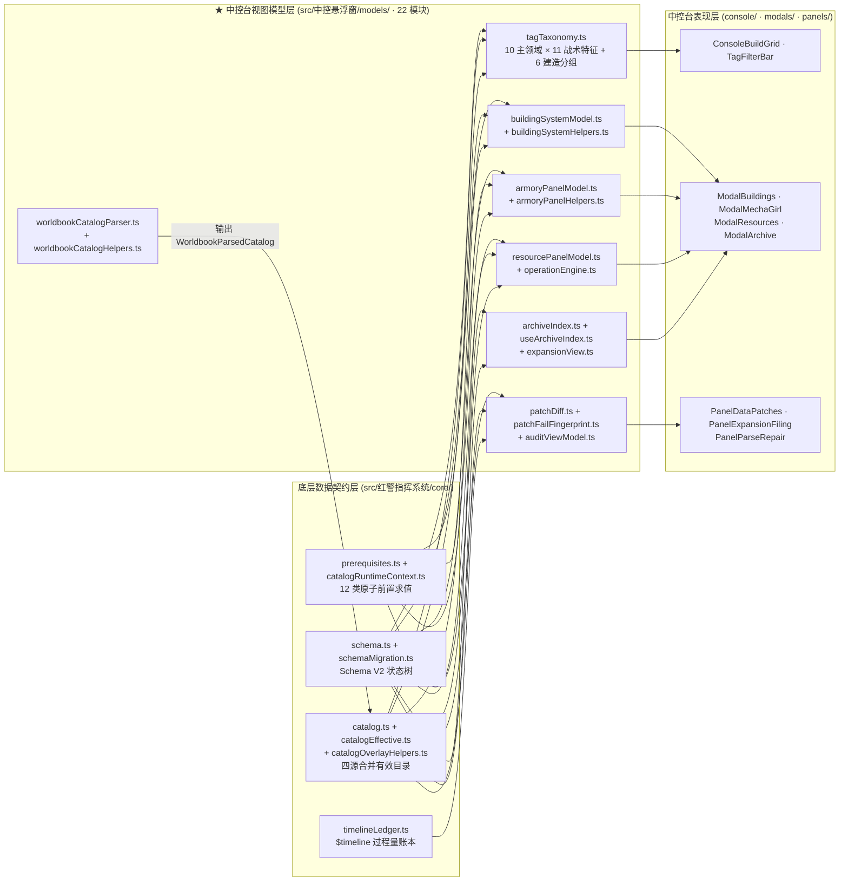

# 01 · 核心数据模型与目录契约层（`src/中控悬浮窗/models/` 协同 `src/红警指挥系统/core/`）

> **第一核心描述对象**：`mvu指挥系统/src/中控悬浮窗/models/`（22 个视图模型、世界书目录解析器、战术标签分类学、图鉴索引与补丁模型）。
> **协同底层数据底座**：`mvu指挥系统/src/红警指挥系统/core/`（11 个核心契约模块：Schema V2、多世界 Manifest、四源有效目录合并器、12 类前置条件求值器、时间线账本）。

---

## 1. 架构定位：从底层 `core/` 状态契约到中控台 `models/` 视图模型

在双工程协同架构中，数据模型与目录契约分为上下紧密咬合的两层：

1. **底层数据真源层（`src/红警指挥系统/core/`）**：定义全系统唯一的 Zod 状态树契约（`Schema` V2）、多世界规则（`worlds.ts`）、参谋与阵营预设（`commandPresets.ts`）、静态基础目录（`catalog.ts`）、四源合并有效目录（`catalogEffective.ts`）、12 类前置门禁求值器（`prerequisites.ts`）以及聊天级时间线账本（`timelineLedger.ts`）。
2. **中控台视图模型与解析层（`src/中控悬浮窗/models/`）**：作为连接底层 `core/` 数据与中控悬浮窗 `console/`、`modals/`、`panels/` 界面的**纯函数转换枢纽**。它将世界书中的自由设定词条解析为结构化目录（`worldbookCatalogParser.ts`），为所有建造/研发/生产项打上 10×11 维战术标签（`tagTaxonomy.ts`），并将枯燥的 `Schema` 状态树投影为五大建筑体系拓扑图（`buildingSystemModel.ts`）、军械库与机娘花名册（`armoryPanelModel.ts`）、六大战略资源柱（`resourcePanelModel.ts`）、世界书图鉴索引（`archiveIndex.ts`）以及动态补丁 Diff 视图（`patchDiff.ts`）。

---

## 2. `src/中控悬浮窗/models/` 22 个模块职责全表

| 模块分组 | 模块路径（相对于 `src/中控悬浮窗/`） | 消费的底层 `core/` 模块 | 核心职责与关键导出符号 |
|---|---|---|---|
| **世界书目录解析族** | `models/worldbookCatalogParser.ts` `models/worldbookCatalogHelpers.ts` | `core/schema.ts` `core/prerequisites.ts` | 解析世界书中的 `【科技】`、`【建筑】`、`【生产】`、`【改装】`、`【工程】`、`【协议】`、`【载具】`、`【人员】`、`【装备】` 词条与 `[数据]` 块，清洗量产后缀，提取额定输入/输出/存储/Buff 与前置条件，输出 `WorldbookParsedCatalog` 与 `UnitEnhancementMap` |
| **战术标签与建造分组** | `models/tagTaxonomy.ts` | `core/catalogEffective.ts` `core/schema.ts` | 定义 10 大主领域（`PRIMARY_DOMAINS`）+ 11 大战术特征（`SECONDARY_TRAITS`）标签分类学，以及侧边建造网格的六大分组（`BUILD_PANEL_GROUPS`：发电/矿业/防卫/工业/科研/兵营与车间）与二级生产子栏（`PRODUCTION_SUBS`），导出 `inferItemTags` |
| **建筑五大体系模型** | `models/buildingSystemModel.ts` `models/buildingSystemHelpers.ts` | `core/schema.ts` `core/catalogEffective.ts` `core/prerequisites.ts` | 构建基地建筑五大体系（指挥/发电/采矿/防卫/农业，`BUILDING_SYSTEM_TABS`）SVG 拓扑蓝图节点、双模建筑识别（`isDualModeBuildingName`）、防卫三环（`DefenseRing`：内环/中环/外环）与农业生态阶段（`AgroStage`）聚合模型 |
| **军械库与机娘模型** | `models/armoryPanelModel.ts` `models/armoryPanelHelpers.ts` | `core/schema.ts` `core/catalogEffective.ts` | 聚合 `stat_data.forces`、`girls`、`bases`、在产队列与世界书机娘能力卡/剧情卡，生成机娘花名册视图（`ArmoryGirlRecord`）、常规人员编制行（`ArmoryPersonnelRow`）与载具集群分组（`ArmoryVehicleGroup`） |
| **经济与工况视图模型** | `models/resourcePanelModel.ts` `models/operationEngine.ts` | `core/schema.ts` `core/catalogEffective.ts` | `resourcePanelModel` 构建六大战略资源柱（资金/电力/矿石/算力/纳米/太空，`RESOURCE_PILLARS`）与日净现金流视图；`models/operationEngine.ts` 计算中控台侧建筑额定产出、基地环境 Buff 触发汇总与单建筑工况诊断 |
| **日程与队列显示模型** | `models/schedulePanelModel.ts` `models/queueDisplayModel.ts` | `core/schema.ts` `core/catalogEffective.ts` | `schedulePanelModel` 将基地产线、11 科研槽、巨构工程与战略协议同源投影为甘特看板；`queueDisplayModel` 格式化队列条目的剩余时间、百分比与状态色调（`QueueTone`） |
| **车间/协议/调度指令模型** | `models/engCommands.ts` `models/engScene.ts` `models/engSceneAsset.ts` `models/protocolCommands.ts` `models/dispatchOrderText.ts` | `core/schema.ts` `core/catalog.ts` | 构造工程车间立项/注资/暂缓/恢复/撤项指令与 SVG 热区场景（`engCommands`/`engScene`/`engSceneAsset`）、三阶协议院所实验/排程指令（`protocolCommands`）及队列四动词调度令（`dispatchOrderText`）（详见 `02` 篇） |
| **世界书与图鉴索引族** | `models/archiveIndex.ts` `models/useArchiveIndex.ts` `models/expansionView.ts` | `core/catalog.ts` `core/schema.ts` | `archiveIndex` 聚合《角色档案_世界书》《角色剧情_世界书》《辅助世界书》与聊天绑定世界书词条，按类别（科技/建筑/载具/人员/装备/机娘/剧情/待审）建立全文检索索引；`useArchiveIndex` 封装响应式缓存；`expansionView` 提供聊天书词条分组与私产提升建议 |
| **对账与补丁指纹族** | `models/auditViewModel.ts` `models/patchDiff.ts` `models/patchFailFingerprint.ts` | `core/schema.ts` `core/catalogEffective.ts` `core/timelineLedger.ts` | `auditViewModel` 构建 R20 生产对账三色门过滤视图；`patchDiff` 计算 `<数据更新>` 补丁与当前 `EffectiveCatalog` 的字段级差异预览；`patchFailFingerprint` 管理补丁失败指纹桶（`$patch_fail_fp`）与跨分支克隆 |

---

## 3. 核心协同链路深度剖析

### 3.1 世界书动态目录解析与四源有效目录合并闭环

中控悬浮窗的建造网格（`ConsoleBuildGrid.vue`）、科技树（`ModalTechTree.vue`）、参谋运行器（`host/advisoryRunner.ts`）与日程运行器（`host/scheduleRunner.ts`）能够实时感知世界书中新增的自定义单位、建筑与科技，归功于 **`src/中控悬浮窗/models/worldbookCatalogParser.ts`** 与 **`src/红警指挥系统/core/catalogEffective.ts`** 的双向衔接：

1. **第一阶段：世界书词条结构化解析（`models/worldbookCatalogParser.ts` + `worldbookCatalogHelpers.ts`）**
   - 扫描当前激活的全局世界书与聊天绑定世界书中的所有启用词条；
   - 识别词条名称前缀（`【科技】`、`【建筑】`、`【生产】`、`【改装】`、`【工程】`、`【协议】`、`【载具】`、`【人员】`、`【装备】`），调用 `worldbookCatalogHelpers.ts` 剥离量产编号后缀并提取 `[数据]` 块；
   - 使用 `ResourceRateSchema`、`EntityInputsSchema`、`EntityOutputsSchema`、`OperationalBuffSchema` 校验并提取造价、工期、发电/耗电、算力产出、纳米消耗与工况 Buff；
   - 调用 `core/prerequisites.ts` 将自然语言前置条件解析为标准 `PrerequisiteExpr` 语法树，输出 `WorldbookParsedCatalog`。
2. **第二阶段：四源确定性合并（`core/catalogEffective.ts` + `core/catalogOverlayHelpers.ts`）**
   - `composables/useCatalog.ts` 将上述 `WorldbookParsedCatalog` 传入 `core/catalogEffective.ts` 的 `mergeEffectiveCatalog()`；
   - 按严格优先级执行同名字段级深合并（`mergeByName`）：
     $$\text{静态基础目录 } (\text{catalog.ts}) \;\prec\; \text{已安装 DLC Overlay } (\$dlc) \;\prec\; \text{动态世界书目录 } (\text{worldbookCatalogParser}) \;\prec\; \text{楼层数据补丁 } (\text{applied\_data\_patches})$$
   - 合并后调用 `computeHiddenTechIds` 与 `filterVisibleResearches`，自动隐藏尚未通过战略协议揭露（`revealed_tech_ids`）的黑科技条目。

### 3.2 12 类原子前置求值与 10×11 战术标签检索（`core/prerequisites.ts` → `models/tagTaxonomy.ts`）

当玩家在侧边主控台打开 `ConsoleBuildGrid.vue` 并点击 `TagFilterBar.vue` 时：

1. **运行态前置求值上下文（`core/catalogRuntimeContext.ts` + `core/prerequisites.ts`）**：
   - `buildCatalogRuntimeContext(statData, currentBaseName)` 从 `Schema` 快照提取当前基地的已建建筑集合、在场人员/载具/机娘、已完成科技、资源库存与已激活协议；
   - `evaluatePrerequisite(expr, ctx)` 对 12 类合法原子条件（`tech`、`building`、`base_tier`、`faction`、`girl_present`、`unit_present`、`resource_min`、`world`、`tag_held`、`quest_done`、`project_milestone`、`protocol_active`）执行递归求值（最大深度 `MAX_PREREQUISITE_DEPTH = 6`），返回精确的布尔解锁态与缺失项诊断列表（`PrerequisiteMissing[]`）。
2. **战术标签分类与六大建造分组（`models/tagTaxonomy.ts`）**：
   - `inferItemTags(item)` 根据条目所属目录类型、输入输出特征与描述关键词，自动推导 **10 大主领域**（能源、矿业、防卫、步兵、装甲、航空、海军、电子战、超武与巨构、后勤）与 **11 大战术特征**（防空、反装甲、两栖、隐身、高耗电、算力节点、纳米装配等）；
   - 将当前选中基地可建造/可生产的条目投射到 `BUILD_PANEL_GROUPS`（6 个主建造页签）与 `PRODUCTION_SUBS`（人员/载具/军备二级子栏），驱动 `ConsoleBuildGrid.vue` 的高密度红警建造网格。

### 3.3 五大建筑体系拓扑与军械库多源聚合（`buildingSystemModel` & `armoryPanelModel`）

- **`models/buildingSystemModel.ts` + `buildingSystemHelpers.ts`**：
  消费 `stat_data.bases` 与 `EffectiveCatalog.buildings`，将基地内建筑划分为 **指挥体系、发电体系、采矿体系、防卫体系、农业体系（`BUILDING_SYSTEM_TABS`）** 五大板块，计算每个体系的额定/实际功率、双模建筑（如重装/轻装产线）当前模式、三道防卫环（内环/中环/外环）火力密度以及农业生态阶段（`AgroStage`），直接驱动 `modals/ModalBuildings.vue` 的交互式 SVG 拓扑图。
- **`models/armoryPanelModel.ts` + `armoryPanelHelpers.ts`**：
  同时消费 `stat_data.girls`、`stat_data.forces`、`stat_data.bases`、`stat_data.pending_girls` 以及 `models/archiveIndex.ts` 从世界书读取的机娘档案卡，通过 `armoryPanelHelpers.ts` 完成角色同名合并、四维属性（体质/灵巧/精神/魅力）与好感/服从/堕落/心情状态归一化，为 `modals/ModalMechaGirl.vue` 提供跨基地与单基地双视角数据源。

### 3.4 底层 `Schema` (V2) 与 `$timeline` 账本对补丁模型的支撑

- **`core/schema.ts` + `core/schemaMigration.ts`**：定义 `SCHEMA_VERSION = 2` 的 24 个顶层切片（含 `meta`、`world`、`resources`、`bases`、`forces`、`tech`、`queues`、`projects`、`protocols`、`command`、`girls`、`factions`、`intel`、`quests`、`events`、`chains`、`summaries`、`codex`、`applied_data_patches`、`pending_*` 等），并在读取旧存档时自动执行 `migrateV1toV2` 与 18 条存量协议无损迁移（`migrateLegacyProtocolsInState`）。
- **`core/timelineLedger.ts` → `models/patchDiff.ts` & `models/patchFailFingerprint.ts`**：
  - `timelineLedger.ts` 在聊天变量 `$timeline` 中按楼层/Swipe 键（`f_${floorId}` / `s_${swipeId}`）记录 4 类非 Raw 过程量增量（`applied_data_patches`、已消费 `pending_*`、已入档 `codex`、手动修订 `manual_overrides`）及世界书写入日志 `wbJournal`；
  - `models/patchDiff.ts` 对比待审补丁与 `EffectiveCatalog` 生成字段级修改前/修改后预览；
  - `models/patchFailFingerprint.ts` 生成确定性指纹 `patchFingerprint`，在 `PanelDataPatches.vue` 驳回补丁或校验失败时写入聊天变量避免重复弹窗，并在发生聊天分支（Branch）时调用 `clonePatchFingerprintsForBranch` 保持分支隔离。
