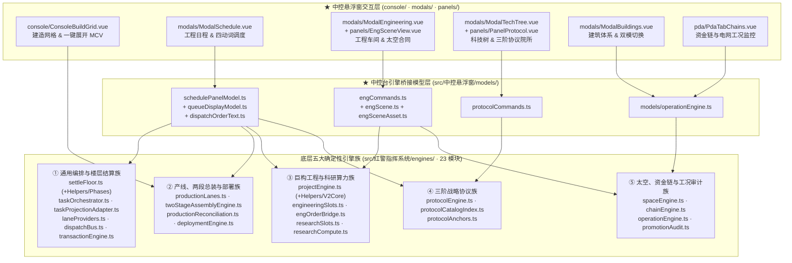

# 02 · 五大确定性推进与事务引擎层（`src/中控悬浮窗` 协同 `src/红警指挥系统/engines/`）

> **第一核心描述对象**：`mvu指挥系统/src/中控悬浮窗/models/`（`schedulePanelModel.ts`、`engCommands.ts`、`engScene.ts`、`engSceneAsset.ts`、`protocolCommands.ts`、`dispatchOrderText.ts`、`queueDisplayModel.ts`、`operationEngine.ts`）以及 `modals/`、`panels/`、`console/` 中的引擎消费面板。
> **协同底层引擎层**：`mvu指挥系统/src/红警指挥系统/engines/`（23 个确定性结算、工位编排、产线、巨构工程 V1/V2、三阶协议、太空合同与资金链引擎模块）。

---

## 1. 架构定位：底层确定性推进引擎 + 中控台只读投影与指令构造器

在红警指挥系统中，所有跨楼层的时间推进（$\Delta t$）、产线吞吐、两阶段纳米总装、MCV 部署展开、巨构工程 V1/V2 推进、三阶协议渐进实验、太空发射合同与资金链现金流结算，均由 **`src/红警指挥系统/engines/`** 下的纯函数引擎在楼层解析阶段确定性完成。

而 **`src/中控悬浮窗`** 则通过 **「只读同源投影（Read-Only Projection）+ 规范化指令报文构造（Structured Command Generation）」** 的双轨模式与底层 `engines/` 协同：

1. **只读同源投影**：中控悬浮窗的 `models/` 直接调用底层 `engines/` 的工位提供者（`laneProviders`）、产线注册表（`productionLanes`）、工程槽（`engineeringSlots`）、协议锚点（`protocolAnchors`）与巨构工程状态机（`projectEngine`），在**不修改任何楼层变量**的前提下，实时计算出当前战局的甘特日程表、工程车间 SVG 热区状态、协议实验成功率与建筑实际工况。
2. **规范化指令构造与填框**：当玩家在中控台点击「立项/注资/分配仓段」「启动协议实验」「置顶/暂缓队列」或「展开基地车」时，`models/` 下的指令构造器（`engCommands.ts`、`protocolCommands.ts`、`dispatchOrderText.ts`）严格依据底层引擎的前置守卫校验结果，生成符合 `parse/` 语法规范的结构化指令报文（如 `<工程>`、`<协议>`、`<部署>` 或调度令文本），并经 `worldbook/hostSendInput.ts` 填入宿主输入框。

---

## 2. 五大确定性引擎族与中控悬浮窗对接矩阵

| 底层引擎族 | 底层核心模块（`src/红警指挥系统/engines/`） | 对接的中控台模型（`src/中控悬浮窗/models/`） | 对接的中控台 UI 组件（`console/` · `modals/` · `panels/` · `pda/`） | 核心协同职责 |
|---|---|---|---|---|
| **① 通用编排与调度事务族** | `settleFloor.ts`, `settleFloorHelpers.ts`, `settleFloorPhases.ts`, `taskOrchestrator.ts`, `taskProjectionAdapter.ts`, `laneProviders.ts`, `dispatchBus.ts`, `transactionEngine.ts` | `schedulePanelModel.ts` `queueDisplayModel.ts` `dispatchOrderText.ts` | `modals/ModalSchedule.vue` `console/ConsoleBuildGrid.vue` | 将 `queues`/`projects`/`protocols` 投影为统一甘特日程行（`ScheduleTxnRow`），计算下一里程碑横幅（`NextMilestoneBanner`），并生成四动词（置顶/置底/暂缓/恢复）调度报文 |
| **② 建造产线、两段式总装与部署族** | `productionLanes.ts`, `twoStageAssemblyEngine.ts`, `productionReconciliation.ts`, `deploymentEngine.ts` | `schedulePanelModel.ts` `buildingSystemModel.ts` `auditViewModel.ts` | `console/ConsoleBuildGrid.vue` `console/ChronoMismatchBanner.vue` `modals/ModalBuildings.vue` `panels/PanelParseRepair.vue` | 九类制造产线（兵营/战车/船厂/空指部/机甲等）容量核算、重装/轻装双模切换、MCV 一键展开建基地指令、生产完成对账三色门（R20）展示 |
| **③ 巨构工程（V1/V2）与科研算力族** | `projectEngine.ts`, `projectEngineHelpers.ts`, `projectEngineV2Core.ts`, `engineeringSlots.ts`, `engOrderBridge.ts`, `researchSlots.ts`, `researchCompute.ts` | `engCommands.ts` `engScene.ts` `engSceneAsset.ts` | `modals/ModalEngineering.vue` `modals/modalEngineeringHelpers.ts` `panels/EngSceneView.vue` | 短期技改、V1 线性分期工程与 V2 仓段化 DAG 巨构工程的立项/注资/暂缓/恢复/撤项指令生成、跨基地工程槽指派与交互式 SVG 装配场景渲染 |
| **④ 三阶战略协议族** | `protocolEngine.ts`, `protocolCatalogIndex.ts`, `protocolAnchors.ts` | `protocolCommands.ts` `schedulePanelModel.ts` | `modals/ModalTechTree.vue` `panels/PanelProtocol.vue` `panels/panelProtocolHelpers.ts` `console/ConsoleQuickActions.vue` | 苏/盟三阶协议院所（T1～T3）协议点日产速率分解、双资源（协议点+资金）渐进概率实验门禁校验、实验指令与自动排程指令构造、主控台可实验徽标提醒 |
| **⑤ 太空合同、资金链与电网工况族** | `spaceEngine.ts`, `chainEngine.ts`, `operationEngine.ts`, `promotionAudit.ts` | `models/operationEngine.ts` `resourcePanelModel.ts` | `modals/ModalEngineering.vue` `modals/ModalResources.vue` `panels/PanelIntegrityCheck.vue` `pda/PdaTabChains.vue` | 航天发射台与气象窗口校验、轨道发射合同交互、基地电网负载与天候衰减系数计算、五态资金链现金流监控、私产提升孤儿审计 |

---

## 3. 核心业务闭环深度剖析

### 3.1 工程日程同源投影与四动词调度闭环（`schedulePanelModel.ts` + `dispatchOrderText.ts` → `ModalSchedule.vue`）

中控悬浮窗的「工程日程」弹窗（`modals/ModalSchedule.vue`）并非简单罗列原始 `stat_data.queues` 数组，而是通过 `models/schedulePanelModel.ts` 复用底层 **通用任务编排器（UTO，`taskOrchestrator.ts`）** 的同源工位拓扑：

1. **四域工位同源投影**：
   - `schedulePanelModel.ts` 实例化 `defaultLaneRegistryHub`（聚合 `laneProviders.ts` 中的产线工位、11 槽科研工位、基地锚定工程槽与战略协议轨道）；
   - 调用 `projectStateToUnifiedTasks`（`taskProjectionAdapter.ts`）与 `buildProductionKanban`（`productionLanes.ts`），将各基地的建筑建造、人员训练、载具制造、军备生产、11 槽科技研发、V1/V2 巨构工程及战略协议统一映射为结构化日程视图（`ScheduleBaseSection[]` 与 `ScheduleProtocolLaneModel`）；
   - 自动计算全局最近即将完工的里程碑（`NextMilestoneBanner`）以及两阶段纳米总装（`twoStageAssemblyEngine.ts`）的「仿真推演期 / 纳米打印期」阶段标识。
2. **四动词调度令构造（`models/dispatchOrderText.ts`）**：
   - 針對每一条事务行，`dispatchVerbButtonsFor(txn)` 根据底层 `transactionEngine.ts` 的五态状态机（`queued` / `active` / `paused` / `cancelled` / `done`）计算四个调度按钮（**置顶 `top`、置底 `bottom`、暂缓 `pause`、恢复 `resume`**）的启用矩阵；
   - 玩家点击按钮后，`dispatchOrderText(target, verb)` 生成标准中文调度令报文（与底层 `dispatchBus.ts` 的动词解析器严格对称），填入宿主输入框。

### 3.2 工程车间、V2 仓段巨构与 SVG 场景交互闭环（`engCommands.ts` + `engScene.ts` → `ModalEngineering.vue`）

`modals/ModalEngineering.vue`（配合 `modalEngineeringHelpers.ts` 与 `panels/EngSceneView.vue`）是中控悬浮窗中最复杂的重工业交互工作台，完整对接底层 `engines/projectEngine.ts`（含 `projectEngineHelpers.ts`、`projectEngineV2Core.ts`）、`engineeringSlots.ts` 与 `spaceEngine.ts`：

1. **三类工程形态与太空合同统一承载**：
   - **短期技改与现代化改装（V1 线性分期链）**：按 `phases[]` 顺序逐期注资、推进与里程碑结算；
   - **模块化巨构工程（V2 仓段 DAG 拓扑，`projectEngineV2Core.ts`）**：如超大型战略武器或空天母舰，拆分为具有前置依赖关系（`dependsOn[]`）的多个仓段（`modules[]`），支持将不同仓段并行指派给不同基地的空闲工程槽（`ENG_SLOT_REGISTRY`）；
   - **太空发射合同（`spaceEngine.ts`）**：校验发射基地是否具备航天发射台、当前天气是否处于禁飞气象（如强雷暴/离子风暴），并管理轨道发射排程。
2. **SVG 交互式装配场景（`models/engScene.ts` + `engSceneAsset.ts` → `panels/EngSceneView.vue`）**：
   - `engSceneAsset.ts` 按需从《工程车间_场景世界书》或《通用引擎_世界书》加载对应巨构工程的原生 SVG 蓝图资产（缺失时回退至 `GENERIC_SCENE_ID` 默认蓝图）；
   - `engScene.ts` 将工程各分期（`PhaseSlice`）或 V2 各仓段（`ModuleSlice`）的实时状态（锁定/待注资/施工中/已完工/暂停）映射为 SVG 热区属性（`HotspotState`），在 `EngSceneView.vue` 中实现点击 SVG 仓段即选中对应工程模块并弹出操作菜单。
3. **五动词工程指令构造（`models/engCommands.ts`）**：
   - 提供 `buildInitiateOrder`（立项）、`buildFundOrder`（分期/仓段注资）、`buildPauseOrder`（暂缓）、`buildResumeOrder`（恢复）、`buildCancelOrder`（撤项）及 `buildCancelSettlement`（撤项资金/矿石折算退回预览），输出标准 `<工程>` 指令块。

### 3.3 苏/盟三阶协议院所与双资源概率实验闭环（`protocolCommands.ts` → `ModalTechTree.vue` + `PanelProtocol.vue`）

`modals/ModalTechTree.vue` 采用「常规科技研发树 + 三阶战略协议院所（`panels/PanelProtocol.vue` + `panelProtocolHelpers.ts`）」双生主厅设计，直接对接底层 `engines/protocolEngine.ts`、`protocolCatalogIndex.ts` 与 `protocolAnchors.ts`：

1. **协议锚点扫描与日产速率分解（`engines/protocolAnchors.ts`）**：
   - 自动扫描全基地已建成的协议锚点建筑（如作战实验室、最高苏维埃院所、超时空枢纽等），结合跨阵营协同折算规则，分解出各阵营 T1/T2/T3 协议点的每日产出速率与全局并网算力。
2. **实验门禁守卫与指令构造（`models/protocolCommands.ts`）**：
   - 调用底层 `protocolEngine.ts` 的状态机校验目标协议是否满足前置协议、锚点建筑阶数、协议点余额与专项实验经费（双资源门禁），返回结构化原因码（`ProtocolExperimentGuardReasonCode`）；
   - 校验通过后生成 `<协议>` 实验指令或自动排程队列指令（`ProtocolScheduleAction`），并在 UI 侧生成暂存回执视图（`ProtocolStagedReceiptView`），同时在侧边主控台 `ConsoleQuickActions.vue` 的 `TECH` 按钮上实时點亮「可实验协议数」角标。

### 3.4 楼层确定性结算主循环（`engines/settleFloor.ts`）对中控台快照的支撑

每当新楼层生成完毕并由 `host/floorObservers.ts` 触发 `useParse.runParseFor()` 时，`engines/settleFloor.ts`（配合 `settleFloorHelpers.ts` 与 `settleFloorPhases.ts`）按严格固定顺序推进全部五大引擎：
1. **解析 $\Delta t$ 时间步长**（`<timePast>` 优先 → 缺省回退 → 附加步进）并清理上楼已完工队列残影；
2. **产线、科研与巨构工程 UTO 步进 + 两阶段纳米总装抵扣**（`LaneRegistryHub` + `settleWithTwoStage`）；
3. **双模建筑切换结算**（`settleModeSwitches`）与 **MCV/建筑部署展开结算**（`settleDeployments`）；
4. **巨构工程 V1/V2 同步与里程碑交付**（`syncProjects`）；
5. **资金链事件、基地电网/天候衰减约束与 $\Delta t$ 现金流积分**（`applyChainEvent` + `applyGridConstraints` + `settleChainsDeltaT`）；
6. **三阶战略协议结算齿轮**（`settleFloorProtocols`）与 **联席参谋部/阵营解锁结算**（`settleCommandHQSlice`）；
7. **R26 资产-队列交叉对账与 R27 部署载具守恒校验**。
结算完成后生成的权威 `Schema` 快照，立即通过 `useFloatingStore.refresh()` 推送至中控悬浮窗全量视图模型。
