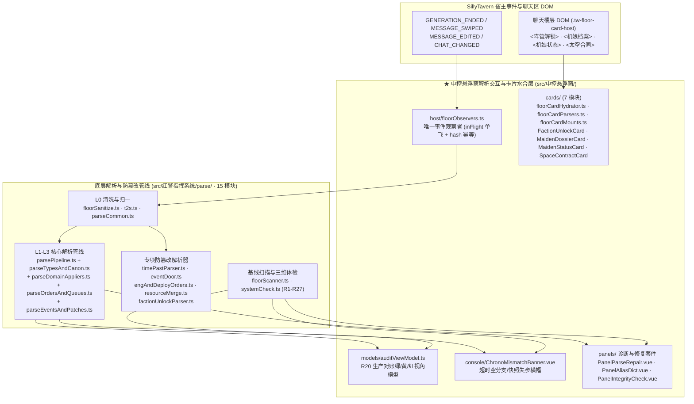
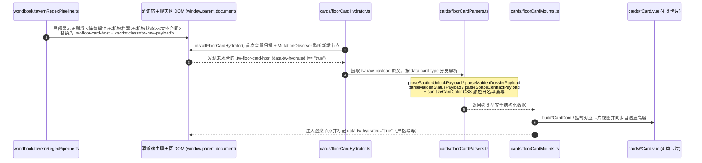

# 03 · 自然语言战报解析与防篡改管线（`src/中控悬浮窗` 协同 `src/红警指挥系统/parse/`）

> **第一核心描述对象**：`mvu指挥系统/src/中控悬浮窗/host/floorObservers.ts`、`models/auditViewModel.ts`、`console/ChronoMismatchBanner.vue`、`panels/`（`PanelParseRepair.vue`、`PanelAliasDict.vue`、`PanelIntegrityCheck.vue`）以及 `cards/`（7 个楼层内嵌卡片水合与渲染模块）。
> **协同底层解析层**：`mvu指挥系统/src/红警指挥系统/parse/`（15 个解析管线、三色裁决门、楼层扫描与三维系统体检模块）及 `composables/useParse.ts`（含 `useParseAuthority.ts`、`useParseReports.ts`）。

---

## 1. 架构定位：中控台事件驱动观察 + 底层 L0-L3 防篡改解析 + 同层卡片水合

在红警指挥系统的运行态中，AI 生成的自然语言楼层正文需要同时完成两件事：
1. **结构化战报提取、三色防篡改裁决与状态结算**：由 **`src/中控悬浮窗/host/floorObservers.ts`** 独家监听酒馆事件并调用 `composables/useParse.ts`，驱动底层 **`src/红警指挥系统/parse/`** 的 L0-L3 四层纯函数解析管线，并将对账结果与修复工具暴露在 **`src/中控悬浮窗/panels/`**（`PanelParseRepair.vue`、`PanelAliasDict.vue`、`PanelIntegrityCheck.vue`）及 **`console/ChronoMismatchBanner.vue`** 中。
2. **聊天区同层富交互卡片水合（`CMD-CARD-01`）**：由 **`src/中控悬浮窗/cards/`** 扫描宿主聊天区中的 `<阵营解锁>`、`<机娘档案>`、`<机娘状态>`、`<太空合同>` 占位容器（`.tw-floor-card-host`），使用 `floorCardParsers.ts` 执行安全消毒解析，并由 `floorCardMounts.ts` 水合挂载为 4 类交互式 Vue 卡片。

---

## 2. 模块协同矩阵（`src/中控悬浮窗` ↔ `src/红警指挥系统/parse/`）

| 中控悬浮窗模块（`src/中控悬浮窗/`） | 协同的底层模块（`src/红警指挥系统/`） | 核心职责与防篡改契约 |
|---|---|---|
| **`host/floorObservers.ts`** | `composables/useParse.ts` `parse/systemCheck.ts` (`tav`) `core/timelineLedger.ts` `worldbook/branchBookCloner.ts` | 全系统唯一楼层解析触发器：监听生成结束/Swipe/编辑/切聊天事件，维护 `inFlight` 按楼层单飞锁与 `expectChatId` 写前复核，按固定顺序执行「`runParseFor` → 多阵营四书同步 → `floatingStore.refresh()`」 |
| **`models/auditViewModel.ts`** | `parse/parsePipeline.ts` `engines/productionReconciliation.ts` | 将底层 R20 生产对账裁决（`pass` 绿门 / `warn` 黄门自动容差补齐 / `quarantine` 红门幻觉拦截）投影为 `ReconcileReportView` 与统计计数器 `reconcileVerdictCounts` |
| **`panels/PanelParseRepair.vue`** | `composables/useParse.ts` (`useParseReports.ts`) `parse/parsePipeline.ts` `parse/systemCheck.ts` | 战报解析与修复主工作台：展示本楼解析事件流（`ParseEvent[]`）、红黄门隔离池（`QuarantineItem[]`）、R20 对账表，支持字段级手动修正（`applyManualFix`）、附加 $\Delta t$ 重解析（`reparseFloorWithExtraDelta`）与强制重跑 |
| **`panels/PanelAliasDict.vue`** | `composables/useParse.ts` (`useParseAuthority.ts`) `parse/systemCheck.ts` | 自定义实体别名词典（聊天变量 `$aliases`）管理面板：将 AI 常用的简称/译名映射至权威 Catalog 标准名，并在保存后触发重解析消除未知实体黄牌 |
| **`panels/PanelIntegrityCheck.vue`** | `parse/systemCheck.ts` `engines/promotionAudit.ts` `core/catalog.ts` | 三维系统体检面板：一键运行 `runSystemCheck()`（R1-R13 环境 API / 变量交叉对账 / 世界书语法校验 + R26/R27 资产守恒）及 `auditPromotedEntries()` 私产提升孤儿审计 |
| **`console/ChronoMismatchBanner.vue`** | `composables/useParse.ts` `engines/productionReconciliation.ts` `parse/systemCheck.ts` | 超时空分支/楼层失步警示横幅：当检测到当前最新 AI 楼缺少 `stat_data`、处于历史分支回退半态或存在未决红门冲突时，在主控台顶部弹出醒目横幅并提供一键对齐/重解析 |
| **`cards/floorCardHydrator.ts`** **`cards/floorCardParsers.ts`** **`cards/floorCardMounts.ts`** + 4 个 `*Card.vue` | `host/modalHost.ts` (`getHostDocument`) （与 `worldbook/tavernRegexPipeline.ts` 生成的占位壳配对） | 扫描宿主聊天区 `.tw-floor-card-host` 容器，读取 `<script type="text/plain" class="tw-raw-payload">` 原始标签文本，经 `floorCardParsers.ts` 消毒解析后由 `floorCardMounts.ts` 水合挂载为 `<阵营解锁>`、`<机娘档案>`、`<机娘状态>`、`<太空合同>` 四类同层卡片 |

---

## 3. 核心管线深度剖析

### 3.1 中控台唯一事件驱动解析闭环（`host/floorObservers.ts` → `useParse.runParseFor`）

根据楼层瘦身契约（`CTRL-FLOOR-SLIM-01`），楼层状态栏严禁自启解析；所有解析均由 `src/中控悬浮窗/host/floorObservers.ts` 统一调度：

1. **事件防抖与单飞锁**：
   - `installFloorObservers(floatingStore)` 注册 `GENERATION_ENDED`、`MESSAGE_SWIPED`、`MESSAGE_EDITED`、`CHAT_CHANGED` 四类酒馆事件；
   - 使用 `inFlight` 集合按 `message_id` 保证同一楼层绝不并发重入；`MESSAGE_EDITED` 默认依赖正文 FNV-1a 哈希（`raw_hash`）幂等判定，仅当战报正文实际变化时才重跑解析。
2. **L0-L3 四层防篡改解析（`src/红警指挥系统/parse/`）**：
   - **L0 原文清洗与繁简归一（`floorSanitize.ts` + `t2s.ts`）**：剥离 `<think>`/`<thinking>` 等思维链容器，过滤 Markdown 代码围栏干扰，并将繁体字映射为标准简体；
   - **L1 宽容切分與块提取（`parsePipeline.ts` + `parseOrdersAndQueues.ts` + `parseEventsAndPatches.ts`）**：提取 `<战况>`/`<状态>`、`<timePast>`、`<生产>`、`<部署>`、`<工程>`、`<事件>`、`<机娘档案>`、`<扩展档案>`、`<数据更新>`、`[WorldbookData]`、`<阵营解锁>` 与 `<排产分析>`；
   - **L2 权威词表三级对齐（`parseTypesAndCanon.ts` + `useParseAuthority.ts`）**：基于 `EffectiveCatalog` + `$aliases` 构建 `AlignIndex`，按「精确匹配 → 自定义别名命中 → 编辑距离 $\le 2$ 模糊对齐」锁定权威标准名，无法对齐的野生名称打入 `quarantine` 隔离池；
   - **L3 三色防篡改裁决门（`parseDomainAppliers.ts` + `resourceMerge.ts` + `eventDoor.ts`）**：
     - **绿门（Pass）**：合法声明与目录内实体变更直接合入新状态树；
     - **黄门（Warn）**：格式轻微偏移或可在容差内自愈的条目（如 R20 生产完成自动补齐）自动修复并记录黄色告警；
     - **红门（Quarantine）**：AI 凭空捏造黑科技、非法篡改核心资金/建筑、超出单楼配额的 `<事件>` 突变或未知单位，**一律拦截在 `stat_data` 之外**，存入 `$parse.quarantine` 供玩家在 `PanelParseRepair.vue` 裁决。
3. **多阵营四书自动同步与快照广播**：
   - 解析落盘后，`floorObservers.ts` 调用 `syncMultiFactionWorldbooksOnFloorEvent` 检查 `stat_data.command.unlocked_factions`，若新解锁了苏联/盟军/尤里阵营，自动联动 `planFactionWorldbookSync` 绑定对应阵营的四本全局世界书与《协议_世界书》；
   - 随后调用 `floatingStore.refresh()` 更新中控台全局只读快照，并触发 `expansionAutoFiler` 与 `girlAutoFiler`。

### 3.2 聊天楼层内嵌卡片水合管线（`src/中控悬浮窗/cards/`）

为了让 AI 在正文中输出的 `<阵营解锁>`、`<机娘档案>`、`<机娘状态>`、`<太空合同>` 标签呈现为精美的高密度红警战术卡片，同时不阻塞酒馆消息流渲染，系统采用了 **「局部正则占壳 + 中控悬浮窗异步水合」** 的双阶段架构：

1. **三模块职责解耦（`floorCardHydrator.ts` / `floorCardParsers.ts` / `floorCardMounts.ts`）**：
   - `cards/floorCardHydrator.ts`（312 行）：负责跨文档获取 `getHostDocument()`、执行首次扫描 `scanAndHydrateFloorCards`、维护 `MutationObserver` 增量监听，并在中控卸载时干净断开观察者；
   - `cards/floorCardParsers.ts`（912 行）：纯函数解析器，负责解析四类卡片的 YAML/键值混合载荷，内置 `isSafeCssColor` 与 `sanitizeCardColor` 防御 CSS 注入攻击，并为苏/盟/尤里三阵营提供默认调色板 `FACTION_DEFAULT_PALETTES`；
   - `cards/floorCardMounts.ts`（842 行）：负责将解析出的强类型载荷（`ParsedFactionUnlock`、`ParsedMaidenDossier`、`ParsedMaidenStatus`、`ParsedSpaceContract`）构建为高保真战术卡片 DOM 或挂载至同源 `iframe.tw-floor-card` 内，彻底隔离酒馆宿主全局样式污染。
2. **四类专项 Vue 卡片组件**：
   - `cards/FactionUnlockCard.vue`：展示新阵营启封徽标、统帅部卷宗、初始机娘入列寄语与初始配给清单；
   - `cards/MaidenDossierCard.vue`：展示机娘编号、代号、阵营归属、四维属性雷达/条形图与战术特长；
   - `cards/MaidenStatusCard.vue`：展示单楼交互后的好感度、服从度、堕落度、心情变化量与实时状态标签；
   - `cards/SpaceContractCard.vue`：展示商业/军事轨道发射合同的载荷吨位、气象要求、报酬与发射窗口状态。
