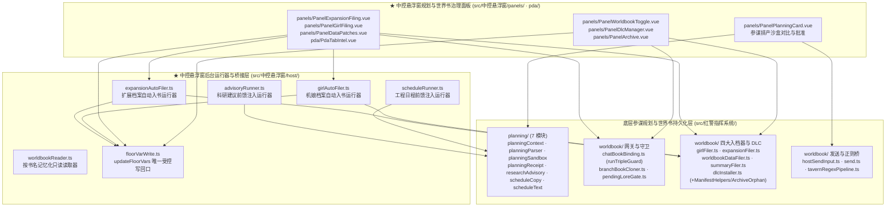

# 04 · 参谋规划与世界书持久化层（`src/中控悬浮窗/host/` & `panels/` 协同 `planning/` & `worldbook/`）

> **第一核心描述对象**：`mvu指挥系统/src/中控悬浮窗/host/`（`advisoryRunner.ts`、`scheduleRunner.ts`、`expansionAutoFiler.ts`、`girlAutoFiler.ts`、`worldbookReader.ts`、`floorVarWrite.ts`）、`panels/`（`PanelPlanningCard.vue`、`PanelWorldbookToggle.vue`、`PanelDlcManager.vue`、`PanelDataPatches.vue`、`PanelExpansionFiling.vue`、`PanelGirlFiling.vue`、`PanelArchive.vue`、`PanelExportSave.vue`）及 `pda/PdaTabIntel.vue`。
> **协同底层规划与世界书层**：`mvu指挥系统/src/红警指挥系统/planning/`（7 个参谋沙盒与前馈文案模块）与 `worldbook/`（13 个世界书绑定守卫、跨分支克隆、四类 Filer、DLC 安装器与宿主发送桥模块）。

---

## 1. 架构定位：后台双路前馈 + 受控自动入档 + 全生命周期世界书治理

在红警指挥系统中，「向 AI 注入当前排产/科研/日程上下文（Feed-Forward）」与「将 AI 产出的新设定/机娘/扩展/数据补丁持久化入世界书（Worldbook Persistence）」是保障长程战役不失忆的两大支柱。

这两大支柱在代码架构上遵循 **「底层纯逻辑与事务守卫在 `src/红警指挥系统/{planning,worldbook}`，事件生命周期与治理 UI 在 `src/中控悬浮窗/{host,panels,pda}`」** 的分层契约：

---

## 2. 模块协同矩阵（`src/中控悬浮窗` ↔ `planning/` & `worldbook/`）

| 中控悬浮窗模块（`src/中控悬浮窗/`） | 协同的底层模块（`src/红警指挥系统/`） | 核心职责与安全边界 |
|---|---|---|
| **`host/advisoryRunner.ts`** | `planning/researchAdvisory.ts` `core/catalogEffective.ts` `composables/useCatalog.ts` | 监听 `GENERATION_STARTED` 记录一次性生成令牌，在 `GENERATION_AFTER_COMMANDS` 调用 `planResearchAdvisory` 推导当前可研发科技与 11 槽负载，通过 `injectPrompts` 注入单轮临时提示词，并在结束/停止/切聊天四路清理 |
| **`host/scheduleRunner.ts`** | `planning/scheduleText.ts` `core/catalogEffective.ts` `composables/useCatalog.ts` | 与 `advisoryRunner` 同构的平行前馈管线：在主生成前调用 `planScheduleInjection` 渲染总参条令体《当前工程日程》（两级分组：本基地在建/在产 + 全局科研/工程/协议），注入后四路清理 |
| **`panels/PanelPlanningCard.vue`** | `planning/planningContext.ts` `planning/planningParser.ts` `planning/planningSandbox.ts` `planning/planningReceipt.ts` `worldbook/hostSendInput.ts` | 参谋排产规划卡面板：展示 AI `<排产分析>` 块提出的 Option A / Option B 排产方案，调用 `runPlanningSandbox` 在克隆状态树上零副作用预演未来 $\Delta t$ 完工序列、资金/电力峰值，点击批准后经 `commitPlanningIntent` 写队列并填框 |
| **`host/expansionAutoFiler.ts`** **`panels/PanelExpansionFiling.vue`** | `worldbook/expansionFiler.ts` `worldbook/chatBookBinding.ts` `host/floorVarWrite.ts` | 负责 `<扩展档案>`（科技/建筑/载具/人员/装备五类动态扩充）的自动或手动入档聊天绑定世界书、同步写入 `stat_data.codex` 图鉴，以及将验证成熟的聊天私产提升（Promote）至全局《辅助世界书》 |
| **`host/girlAutoFiler.ts`** **`panels/PanelGirlFiling.vue`** | `worldbook/girlFiler.ts` `composables/useGirlFiler.ts` `host/floorVarWrite.ts` | 负责 `<机娘档案>` 的自动或手动双世界书入档：将能力数值卡写入《角色档案_世界书》、背景剧情卡写入《角色剧情_世界书》，同步更新机娘花名册汇总词条与 `stat_data.girls` |
| **`panels/PanelDataPatches.vue`** | `worldbook/worldbookDataFiler.ts` `models/patchDiff.ts` `models/patchFailFingerprint.ts` `host/floorVarWrite.ts` | `<数据更新>` 动态补丁三通道审核门面板：展示字段级 Diff、拦截禁改核心键（如 `id`/`name`/`cost` 底线），支持一键应用至聊天世界书、`stat_data.applied_data_patches` 或驳回拉黑指纹 |
| **`panels/PanelDlcManager.vue`** **`panels/PanelArchive.vue`** **`panels/PanelWorldbookToggle.vue`** | `worldbook/dlcInstaller.ts` `worldbook/dlcManifestHelpers.ts` `worldbook/dlcArchiveOrphan.ts` `worldbook/chatBookBinding.ts` | DLC 扩展包管理与世界书总控套件：支持 YAML/JSON 万能导入、R1-R12 静态预检、聊天 `$dlc` 与世界书词条双源事务安装/卸载回滚、孤儿词条归档恢复，以及多世界/阵营世界书一键开关 |
| **`pda/PdaTabIntel.vue`** | `worldbook/pendingLoreGate.ts` `worldbook/chatBookBinding.ts` `host/floorVarWrite.ts` | 战地手持板「待审情报」页签：展示 `stat_data.pending_lore` 中的新设定/人物/地点词条，支持玩家点击「确认入书」或「驳回丢弃」，并配合跨楼推进自动入书门禁 |
| **`host/worldbookReader.ts`** | `models/archiveIndex.ts` `models/useArchiveIndex.ts` | 中控悬浮窗专属世界书只读读取器：封装 `getWorldbook(name)`，在同一刷新周期内按书名记忆化缓存 Promise，并在 `useFloatingStore.onRefresh` 触发时自动调用 `invalidate()` 清空缓存 |

---

## 3. 核心协同机制深度剖析

### 3.1 后台双路前馈注入运行器（`advisoryRunner.ts` & `scheduleRunner.ts`）

为了让 LLM 在生成下一楼战报时精准掌握「当前有哪些科技可研发、11 个科研槽哪些空闲」以及「各基地产线/工程槽正在生产什么、还剩多久完工」，`src/中控悬浮窗/index.ts` 启动了两个平行运行器：

1. **一次性核心生成令牌守卫（防后台静默生成污染）**：
   - 酒馆插件或脚本调用自定义 `generate()` 时往往只触发 `GENERATION_AFTER_COMMANDS` 而不触发 `GENERATION_STARTED`；
   - `advisoryRunner.ts` 与 `scheduleRunner.ts` 严格要求先在 `GENERATION_STARTED` 记录一次性令牌，随后在 `GENERATION_AFTER_COMMANDS(type, options, dryRun)` 中消费该令牌（且排除 `dryRun === true`），从而确保**仅在玩家发起的正式楼层生成中注入提示词**。
2. **纯函数推导与四路幂等清理**：
   - `advisoryRunner` 调用 `planning/researchAdvisory.ts` 的 `planResearchAdvisory(statData, effectiveCatalog)`；`scheduleRunner` 调用 `planning/scheduleText.ts` 的 `planScheduleInjection(statData, effectiveCatalog)`；
   - 若推导结果非空，调用 Tavern Helper 的 `injectPrompts` 注入带唯一 ID 的临时提示词；
   - 在 `GENERATION_ENDED`、`GENERATION_STOPPED`、`CHAT_CHANGED` 以及组件 `stop()` 卸载四条路径上均强制调用 `uninjectPrompts`，保证零残留。

### 3.2 参谋排产沙盒预演与零时间边界批准（`PanelPlanningCard.vue` ↔ `planning/`）

当玩家面对复杂的多基地排产决策时，AI 参谋可在战报中输出 `<排产分析>` 块，由中控悬浮窗 `modals/ModalSchedule.vue` 内嵌的 **`panels/PanelPlanningCard.vue`** 渲染为交互式参谋规划卡：

1. **真实引擎克隆态沙盒预演（`planning/planningSandbox.ts`）**：
   - `runPlanningSandbox(statData, option, catalog)` 使用 `klona` 深拷贝当前 `stat_data`，在内存沙盒中将候选方案（Option A 或 Option B）的建造/生产/研发序列投入真实的 `settleFloor` 与 `twoStageAssemblyEngine` 进行多步长推演；
   - 精确返回预计总工期、各阶段完工时间轴、资金/矿石消耗曲线、电力净余低谷与纳米库存缺口，在 `PanelPlanningCard.vue` 中生成并排对比视图，**对真实存档零副作用**。
2. **零时间边界批准提交（`planning/planningReceipt.ts`）**：
   - 玩家点击「批准方案 A/B」后，`commitPlanningIntent` 仅将批准的排产条目写入当前楼层 `queues`（状态为 `queued`，$\Delta t = 0$，绝不提前偷跑结算工期），同时通过 `worldbook/hostSendInput.ts` 将标准批准回执报文填入宿主输入框，交由下一楼正式结算推进。

### 3.3 聊天绑定世界书三重守卫与跨分支克隆回滚（`worldbook/` 底层保障）

无论是 `host/expansionAutoFiler.ts`、`host/girlAutoFiler.ts` 的后台自动入档，还是玩家在 `panels/PanelExpansionFiling.vue`、`PanelDataPatches.vue`、`PanelDlcManager.vue`、`pda/PdaTabIntel.vue` 中的手动入书，底层全部收口于 `src/红警指挥系统/worldbook/chatBookBinding.ts` 与 `branchBookCloner.ts`：

1. **聊天世界书唯一网关与三重写前守卫（`chatBookBinding.ts` · `CTRL-CHATBOOK-01`）**：
   - 每次写入聊天绑定世界书前，必须通过 `runTripleGuard(expectedChatId, targetBookName)`：
     1. **Chat ID 一致性守卫**：确认当前活跃聊天未在异步等待期间发生切换；
     2. **专属前缀守卫**：确认目标世界书名称以受控聊天书前缀开头，严禁误写全局共享世界书；
     3. **绑定关系复核守卫**：确认该世界书仍为当前聊天的有效绑定世界书。
   - 所有并发写请求在进程内通过 `withChatBookLock` 串行化排队，彻底杜绝并发覆盖。
2. **写前词条快照、删楼逆向回滚与跨分支克隆隔离（`branchBookCloner.ts`）**：
   - 每次在第 $N$ 楼向世界书新建或修改词条前，自动将词条修改前快照记录到 `$timeline.floors["f_N"].wbJournal`；
   - 当玩家删除楼层或重新生成导致楼层数回退时，`host/floorObservers.ts` 调用 `reconcileDeletedFloorsAbove` 逆序回放 `wbJournal`，将世界书精确还原至第 $N-1$ 楼状态；
   - 当玩家创建酒馆聊天分支（Branch）时，`ensureBranchWorldbookIsolation` 自动为新分支克隆独立的聊天绑定世界书，避免主线与分支互相污染设定。
