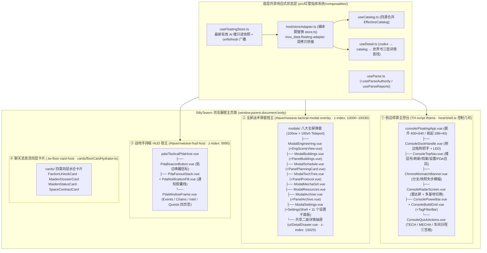

# 05 · 响应式状态与界面表现层（`src/中控悬浮窗` 六大表现与宿主层 协同 `composables/` & `ui/`）

> **第一核心描述对象**：`mvu指挥系统/src/中控悬浮窗` 的六大表现与宿主层——`host/`（11 模块）、`console/`（10 模块）、`modals/`（10 模块）、`panels/`（16 模块）、`cards/`（7 模块）、`pda/`（11 模块）。
> **协同底层状态与 UI 层**：`mvu指挥系统/src/红警指挥系统/composables/`（8 个 Pinia 状态与解析编排模块）及 `ui/`（共享基础组件、样式变量与瘦身楼层状态栏面板）。

---

## 1. 架构定位：中控台四域视窗拓扑（侧边主控台 + 全屏战术弹窗 + 战地手持板 + 同层水合卡片）

不同于传统仅在单条聊天消息内渲染的酒馆前端，`mvu指挥系统/src/中控悬浮窗` 利用自身长驻角色脚本 iframe（`TH-script--*`）的优势，在浏览器宿主视口中构建了**四域协同的立体战术 HUD 架构**：

---

## 2. 响应式状态层：从 `composables/` 到 `host/storeAdapter.ts` 的数据流闭环

### 2.1 `src/红警指挥系统/composables/` 8 个模块与中控台对接关系

| 底层 Composable 模块 | 中控台桥接与消费方（`src/中控悬浮窗/`） | 核心状态契约与生命周期 |
|---|---|---|
| **`composables/useFloatingStore.ts`** | `index.ts`、`host/floorObservers.ts`、`host/storeAdapter.ts`、`console/FloatingApp.vue`、各 `modals/` 与 `panels/` | 中控悬浮窗的核心状态真源：通过 `scanLatestValidFloor` 逆序定位最近合法 AI 楼，暴露只读 `snapshot`（`Schema` V2）、`sourceFloor`、`status`（`ok`/`empty`/`error`）及 `onRefresh(cb)` 广播钩子 |
| **`composables/store.ts`** （编译期重定向至 **`host/storeAdapter.ts`**） | `composables/useCatalog.ts`、`panels/*`、`console/ChronoMismatchBanner.vue` | 楼层终端内为 `defineMvuDataStore`；在中控悬浮窗打包时由 `store_adapter_redirect()` 替换为 `host/storeAdapter.ts`，将 `useDataStore().data` 映射为 `klona(useFloatingStore().snapshot)`，实现**零修改复用组件 + 零非授权写回** |
| **`composables/useCatalog.ts`** | `console/ConsoleBuildGrid.vue`、`modals/ModalTechTree.vue`、`host/advisoryRunner.ts`、`host/scheduleRunner.ts` 等 | 响应式四源有效目录 Store：订阅 `useFloatingStore.onRefresh` 与世界书变更，调用 `models/worldbookCatalogParser.ts` 与 `core/catalogEffective.ts` 输出实时 `EffectiveCatalog` |
| **`composables/useParse.ts`** **`composables/useParseAuthority.ts`** **`composables/useParseReports.ts`** | `host/floorObservers.ts`、`panels/PanelParseRepair.vue`、`panels/PanelAliasDict.vue`、`console/ChronoMismatchBanner.vue` | 全链路解析与结算编排器：`runParseFor` 串联基线扫描、`parseMessageText`、`settleFloor`、R20 对账、工程/参谋回执提交与 `$timeline` 重放落盘；子模块分别管理权威对齐词表（`$aliases`）与诊断报告/时序冲突暂存（`ChronoStash`） |
| **`composables/useDetail.ts`** | `console/FloatingApp.vue`、`console/ConsoleBuildGrid.vue`、`modals/*`、`ui/DetailDrawer.vue` | 全局二级详情抽屉状态机：调用 `openDetail(name, category)` 时按 **「本楼 `stat_data.codex` → 当前 `EffectiveCatalog` → 世界书档案兜底」** 三级查找条目详情并弹出 `DetailDrawer.vue` |
| **`composables/useGirlFiler.ts`** | `host/girlAutoFiler.ts`、`panels/PanelGirlFiling.vue` | 封装机娘档案待审列表、入档进度与手动/自动归档日志状态 |

---

## 3. `src/中控悬浮窗` 六大表现与宿主层深度剖析

### 3.1 `host/` 层：壳层几何、跨文档弹窗宿主与安全守卫（11 个模块）

1. **悬浮窗壳层几何与停靠状态机（`host/shell.ts`）**：
   - 将 Tavern Helper 默认隐藏（`v-show="false"` / `display: none`）的角色脚本 iframe（`window.frameElement`）激活为 `display: block; position: fixed`；
   - 支持 **`right`（右贴边，默认）、`left`（左贴边）、`free`（自由拖拽）** 三种停靠模式（`DockMode`），展开态默认 `400×640`，收起态 `288×40`，窄屏（`< 640px`）自动钳位防裁切，并将位置与折叠态持久化至 `localStorage`（`tavernweave.floating.shell.v1`）。
2. **全视窗弹窗宿主与四层 Z-Index 栈治理（`host/modalHost.ts`）**：
   - 解决侧边栏 iframe 宽度仅 `400px` 无法容纳大型战术弹窗的核心痛点：在 `window.parent.document.body` 下创建全视窗覆盖层 `#tavernweave-tactical-modal-overlay`（`100vw × 100vh`）；
   - 通过 `MutationObserver` 动态克隆主应用全部 `<style>` 与 `adoptedStyleSheets`（含 TailwindCSS、Vue Scoped CSS、`global.css`），并将阵营主题 CSS 变量字典（`THEME_CSS_VARS`：`allied` / `soviet` / `yuri`）直接注入模态框根容器；
   - 严格治理 **Tactical Z-Index Hierarchy**：
     - 战地手持板 HUD 宿主（`#tavernweave-hud-host`）：`z-index: 9995`
     - 模态蒙层底座：`z-index: 10000`
     - 八大主模态卡片（`modals/*`）：`z-index: 10010`
     - 二级详情抽屉（`ui/DetailDrawer.vue`）：`z-index: 10020`
     - 系统通知 / Toastr 提示：`z-index: 10030`
   - 内置 LIFO（后进先出）`Escape` 键栈：按下 `Esc` 时优先关闭顶层 `DetailDrawer`，再关闭当前主模态窗。
3. **模态框渲染异常守卫（`host/modalErrorGuard.ts`）**：
   - 在 `FloatingApp.vue` 注册 `onErrorCaptured`（`useModalErrorGuard`）：一旦某个弹窗组件在渲染期抛出异常，自动追溯所属弹窗根组件并立即将 `activeModal` 置空、调用 `setModalHostVisible(false)` 释放全屏遮罩，彻底杜绝「弹窗报错白屏但全屏 `pointer-events: auto` 把酒馆主页面锁死」的故障。

### 3.2 `console/` 层：红警经典侧边主控台组件群（10 个模块）

`console/FloatingApp.vue` 作为中控台根组件，自上而下装配了致敬经典《命令与征服：红色警戒》侧边建造栏的完整 HUD：

| 组件 / 模块 | 行数 | 核心职责与交互细节 |
|---|---:|---|
| **`console/FloatingApp.vue`** | 505 行 | 根组件：协调阵营主题（`data-theme`）、装配侧边栏六大区域、通过 `<Teleport>` 挂载八大弹窗与 `DetailDrawer.vue`、挂载 `TacticalPdaHost.vue`、安装只读守卫与 `useModalErrorGuard` |
| **`console/ConsoleDockHandle.vue`** | 164 行 | 侧边吸附把手：提供展开/收起切换、Pointer 跨屏增量拖拽（`screenX`/`screenY`）、左右贴边切换与运行态 LED 指示灯 |
| **`console/ConsoleTopNav.vue`** | 271 行 | 顶栏导航：显示当前快照基准楼层号（`#F12`）、手动刷新按钮、档案图鉴入口、设置入口及战地 PDA 召回按钮 |
| **`console/ChronoMismatchBanner.vue`** | 413 行 | 超时空失步警示横幅：实时对比当前楼层、`$timeline` 账本与对账状态，发现失步或未决冲突时提供一键重解析/修复入口 |
| **`console/ConsoleRadarScreen.vue`** | 379 行 | 基地雷达监视屏：动态渲染苏/盟/尤里阵营战术雷达扫描动效、当前基地等级/坐标/驻军概览，并提供多基地快速切换下拉框 |
| **`console/ConsolePowerBar.vue`** | 228 行 | 左侧竖向能量柱：实时计算当前基地或全局的发电/耗电比值，满载绿色、紧平衡黄色、过载（`LOW POWER`）红闪告警 |
| **`console/ConsoleBuildGrid.vue`** + **`consoleBuildGridHelpers.ts`** | 1413 行 | 核心建造与排产网格：包含六大基建页签（发电/矿业/防卫/工业/科研/兵营与车间）、二级生产子栏（人员/载具/军备）、多维标签过滤、双三角翻页、前置锁定原因悬浮提示、一键展开 MCV 建基地与点击填框排产 |
| **`console/TagFilterBar.vue`** | 310 行 | 多维战术标签检索胶囊栏：支持按 10 大主领域与 11 大战术特征组合筛选建造/生产项 |
| **`console/ConsoleQuickActions.vue`** | 213 行 | 底部快捷动作三宫格：一键呼出科技/协议主厅（`TECH`，含可实验协议数动态徽标）、机娘/军械库（`MECHA`）、工程车间与日程（`ENG / SCHED`）及全局资源弹窗 |

### 3.3 `modals/` 与 `panels/` 层：八大全屏战术弹窗与 16 个专项子面板

八大全屏弹窗（`modals/`）与 16 个子面板（`panels/`）构成“容器—内容”二级装配结构：

| 全屏模态窗（`modals/`） | 装配的子面板（`panels/`） | 消费的视图模型（`models/`） | 核心功能闭环 |
|---|---|---|---|
| **`ModalEngineering.vue`** + `modalEngineeringHelpers.ts` | `panels/EngSceneView.vue` | `engCommands.ts` `engScene.ts` `engSceneAsset.ts` | 工程车间全屏工作台：切换短期技改、V1 分期工程、V2 仓段化巨构工程与太空发射合同；渲染交互式 SVG 装配场景并生成立项/注资/仓段指派/撤项指令 |
| **`ModalBuildings.vue`** + `modalBuildingsHelpers.ts` | `panels/PanelBuildings.vue` | `buildingSystemModel.ts` `buildingSystemHelpers.ts` `models/operationEngine.ts` | 基地建筑总览：在五大体系（指挥/发电/采矿/防卫/农业）SVG 拓扑蓝图与分类列表（`PanelBuildings.vue`）间切换，支持双模切换与建筑工况诊断 |
| **`ModalSchedule.vue`** | `panels/PanelPlanningCard.vue` | `schedulePanelModel.ts` `dispatchOrderText.ts` `queueDisplayModel.ts` | 工程日程与参谋规划中心：展示多基地产线、11 科研槽、巨构工程与战略协议甘特进度，执行队列四动词调度，并内嵌参谋排产沙盒审批卡 |
| **`ModalTechTree.vue`** | `panels/PanelProtocol.vue` + `panelProtocolHelpers.ts` | `protocolCommands.ts` `worldbookCatalogParser.ts` | 科技与协议双生主厅（`TechModalHall`）：左厅为 T1～T3 科技研发树与 11 槽负载；右厅为苏/盟三阶协议院所（动态院所头衔、算力并网栏、双资源概率实验与自动排程） |
| **`ModalMechaGirl.vue`** | —（内聚三视图） | `armoryPanelModel.ts` `armoryPanelHelpers.ts` `archiveIndex.ts` | 机娘编成与军械库总览：查阅在编机娘四维能力卡、背景剧情卡、好感/服从/堕落/心情状态，以及常规人员与载具集群编制 |
| **`ModalResources.vue`** | — | `resourcePanelModel.ts` `models/operationEngine.ts` | 全局经济与六大战略资源柱详情：展示资金日净收支、各基地矿石精炼、电网余量、科研算力（TFLOPS/TOPS）、纳米库存与太空运力明细 |
| **`ModalArchive.vue`** | `panels/PanelArchive.vue` | `archiveIndex.ts` `useArchiveIndex.ts` | 世界书与设定图鉴百科：按类别全文检索世界书词条与本局 `codex` 图鉴，并管理动态归档与孤儿词条恢复 |
| **`ModalSettings.vue`** | `panels/SettingsShell.vue` + 11 个治理子面板： `PanelParseRepair.vue` · `PanelAliasDict.vue` · `PanelWorldbookToggle.vue` · `PanelDlcManager.vue` · `PanelDataPatches.vue` · `PanelExpansionFiling.vue` · `PanelGirlFiling.vue` · `PanelArchive.vue` · `PanelExportSave.vue` · `PanelIntegrityCheck.vue` · `PanelPlanningCard.vue` | `auditViewModel.ts` `patchDiff.ts` `patchFailFingerprint.ts` `expansionView.ts` | 中控综合治理中心：由 `SettingsShell.vue` 提供左栏分组导航，集中承载战报解析修复、别名词典、世界书开关、DLC 包管理、动态补丁审核、扩展/机娘入档、归档恢复、存档导出与 R1-R27 系统体检 |

### 3.4 `pda/` 层：战地手持板（Tactical PDA）独立微端（11 个模块）

为了避免频繁开关大型全屏弹窗打断阅读聊天流，中控悬浮窗在宿主 HUD 层（`#tavernweave-hud-host`，`z-index: 9995`）额外部署了轻量级独立微端 **`src/中控悬浮窗/pda/`**：

1. **独立状态机与通知队列（`pda/pdaState.ts` + `pda/notificationQueue.ts`）**：
   - `pdaState.ts` 管理 PDA 视窗的展开尺寸（`360×480`）、收起信标尺寸（`48×48`）、左右贴边磁吸（`PDA_SNAP_THRESHOLD`）、自由拖拽位置与当前激活页签（`events` / `chains` / `intel` / `quests`），独立持久化于 `tavernweave.floating.pda.v1`；
   - `notificationQueue.ts` 从最新楼层提取新增战地事件、资金链异动与待审情报，按严重度（`alert` / `warn` / `info`）构建最多 `MAX_FLOOR_NOTIFICATIONS` 条未读通知胶囊，并在删楼回退时自动调用 `pruneNotificationsAboveFloor` 裁剪过期通知。
2. **信标、扇出通知栈与四页签视窗**：
   - 收起态下由 `PdaBeaconButton.vue` 显示贴边战术信标，新事件到达时通过 `PdaFanoutStack.vue` + `PdaNotificationPill.vue` 扇出悬浮通知胶囊，点击胶囊直接展开 `PdaWindowFrame.vue` 并跳转对应页签；
   - 展开态下提供四大战术页签：**`PdaTabEvents.vue`**（战地事件三色过滤与应对动作）、**`PdaTabChains.vue`**（五态资金链监控、电网/天候折损诊断与抢修）、**`PdaTabIntel.vue`**（`pending_lore` 待审设定预览与一键入书/驳回）、**`PdaTabQuests.vue`**（主支线作战任务追踪）。

---

## 4. 与 `src/红警指挥系统/ui/` 的共享组件契约与楼层瘦身护栏

1. **跨工程共享的基础 UI 资产（`src/红警指挥系统/ui/` → `src/中控悬浮窗/`）**：
   - `ui/Icon.vue`：内置全套红警战术矢量图标库，被 `src/中控悬浮窗` 的 `console/`、`modals/`、`panels/`、`pda/` 共 30 处直接导入复用；
   - `ui/DetailDrawer.vue`：全局二级详情抽屉组件，在中控悬浮窗中由 `FloatingApp.vue` Teleport 至 `modalHost` 的 `z-index: 10020` 层级；
   - `ui/ui.ts`：提供阵营主题归一、数字/资源缩写格式化与通用色调辅助函数；
   - `ui/tailwind.entry.css` & `ui/global.css`：在 `src/中控悬浮窗/index.ts` 顶层导入，提供全系统统一的红警 CRT/HUD 视觉基底。
2. **楼层状态栏瘦身护栏（`CTRL-FLOOR-SLIM-01`）**：
   - `src/红警指挥系统/ui/App.vue` 及其 `ui/panels/`（`PanelBase.vue`、`PanelForces.vue`、`PanelTech.vue`、`PanelFactions.vue`、`PanelIntel.vue`、`PanelQuests.vue`、`PanelSummaries.vue`、`PanelSystem.vue`、`ActionBar.vue`、`IntelRow.vue`、`MenuRow.vue`）仅在单条聊天楼层内作**本楼历史快照只读展示**；
   - 由自动化契约单测 `src/红警指挥系统/__tests__/floorContract.test.ts` 强制守护：楼层入口与所有楼层 `.vue` 组件剥离注释后必须保持 **零 `eventOn(`、零 `initParseRunner`、零 `runParseFor`、零 `installAutoFiler`**，确保 `src/中控悬浮窗` 作为全系统唯一后台事件与交互宿主的绝对权威。
