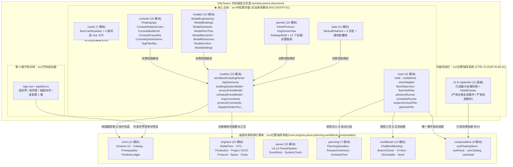

# 战术中控悬浮窗与同源引擎代码架构总览（Code Architecture Index）

> **核心描述对象声明**：本架构文档库（`docs/Architecture/`）以 **`mvu指挥系统/src/中控悬浮窗`**（SillyTavern 角色长驻脚本 · **战术中控悬浮窗工程**，`RAC-ENTRY-01`）为**第一核心描述对象**，系统性阐述其 **7 大领域子目录**（`host/`、`models/`、`console/`、`modals/`、`panels/`、`cards/`、`pda/`）的分层职责、交互闭环与跨 iframe 边界；同时完整呈现它与底层同源领域引擎库 **`mvu指挥系统/src/红警指挥系统`**（7 大子目录：`core/`、`engines/`、`parse/`、`planning/`、`worldbook/`、`composables/`、`ui/`）及第 0 楼向导 **`mvu指挥系统/src/开场启动器`** 的双端同源协同架构。

---

## 1. 文档套件导航总表（7 篇）

| 文档编号 | 文档文件 | 第一核心剖析对象（`src/中控悬浮窗`） | 协同底层引擎层（`src/红警指挥系统`） | 核心架构主题与关键机制 |
|---|---|---|---|---|
| **Index** | [`README.md`](./README.md) | `src/中控悬浮窗/` 全域 | `src/红警指挥系统/` 全域 | 架构文档总索引、双工程 7×7 分层全景矩阵、三大前端入口协同定位、跨层铁律 |
| **00** | [`00_架构总览与目录分层规范.md`](./00_架构总览与目录分层规范.md) | `index.ts` + 7 大领域子目录全景 | 7 大底层领域子目录 + `vite.factory.mjs` | `src/中控悬浮窗` 7 层目录拓扑、单向依赖准则、双端同源架构、`store_adapter_redirect` 与 `in_script_iframe` 跨 iframe 安全边界 |
| **01** | [`01_核心数据模型与目录契约层_core.md`](./01_核心数据模型与目录契约层_core.md) | `models/`（22 个视图模型与目录解析器） | `core/`（Schema V2 / Catalog / Prerequisites / TimelineLedger） | 中控台 `models/` 如何消费底层 `core/` 契约、世界书条目解析器（`worldbookCatalogParser`）、战术标签分类学（`tagTaxonomy`）、建筑体系/军械库/图鉴索引投影 |
| **02** | [`02_五大确定性推进与事务引擎层_engines.md`](./02_五大确定性推进与事务引擎层_engines.md) | `models/` + `modals/` + `panels/` + `console/` | `engines/`（UTO / SettleFloor / Project / Protocol / Space / Chain） | 中控台如何对接底层五大确定性引擎生成只读甘特/车间/协议院所视图，并构造工程指令（`engCommands`）、协议指令（`protocolCommands`）与四动词调度令（`dispatchOrderText`） |
| **03** | [`03_自然语言战报解析与防篡改管线_parse.md`](./03_自然语言战报解析与防篡改管线_parse.md) | `host/floorObservers.ts` + `panels/`（解析修复/别名/体检） + `cards/`（水合器） | `parse/`（L0-L3 解析管线 / 三色门 / SystemCheck R1-R27） | 中控台唯一事件驱动解析入口（`floorObservers`）、R20 对账视角（`auditViewModel`）、`PanelParseRepair` / `PanelAliasDict` / `PanelIntegrityCheck` 交互闭环、聊天楼层卡片水合器（`floorCardHydrator`） |
| **04** | [`04_参谋规划与世界书持久化层_planning_worldbook.md`](./04_参谋规划与世界书持久化层_planning_worldbook.md) | `host/`（四大后台 Runner + `worldbookReader` + `floorVarWrite`） + `panels/`（DLC/世界书/补丁/入档/归档） | `planning/`（排产沙盒 / 科研顾问 / 工程日程） + `worldbook/`（三重守卫 / 分支克隆 / 四类 Filer / DLC） | 后台前馈注入双 Runner（`advisoryRunner` / `scheduleRunner`）、受控自动入档双 Runner（`expansionAutoFiler` / `girlAutoFiler`）、`PanelPlanningCard` 参谋沙盒审批、DLC 与世界书治理面板套件 |
| **05** | [`05_响应式状态与界面表现层_composables_ui.md`](./05_响应式状态与界面表现层_composables_ui.md) | `host/` + `console/` + `modals/` + `panels/` + `cards/` + `pda/` | `composables/`（`useFloatingStore` / `store` / `useCatalog`） + `ui/`（共享组件与面板） | 中控台六大表现与宿主层完整剖析：侧边主控台（`console/`）、八大全屏弹窗（`modals/` + `modalHost`）、设置与功能子面板（`panels/`）、楼层水合卡片（`cards/`）、战地手持板（`pda/`）及跨工程 UI 复用契约 |

---

## 2. 为什么以 `src/中控悬浮窗` 为第一核心描述对象？

在红警指挥系统（TavernWeave Command System）的生产运行态中，SillyTavern 宿主环境存在三个前端工程入口，其中 **`mvu指挥系统/src/中控悬浮窗` 是唯一长驻于角色脚本 iframe（`TH-script--*`）的全功能交互中枢与后台自动化宿主**：

1. **交互主入口收口于 `src/中控悬浮窗`**：玩家在日常游玩中的建造排产（`ConsoleBuildGrid`）、五大建筑体系总览（`ModalBuildings`）、工程车间与 V2 巨构装配（`ModalEngineering` + `EngSceneView`）、三阶协议院所实验（`ModalTechTree` + `PanelProtocol`）、工程日程四动词调度（`ModalSchedule`）、机娘编成（`ModalMechaGirl`）、战地手持板情报/事件/资金链监控（`pda/`）以及 12 项系统治理（`ModalSettings` + `panels/`），100% 承载于 `src/中控悬浮窗`。
2. **后台自动化唯一宿主收口于 `src/中控悬浮窗/host/`**：根据楼层瘦身契约（`CTRL-FLOOR-SLIM-01`），楼层状态栏终端（`src/红警指挥系统/index.ts`）已被剥离全部全局事件监听；全系统的楼层生成/切换解析触发（`floorObservers.ts`）、科研建议前馈注入（`advisoryRunner.ts`）、工程日程前馈注入（`scheduleRunner.ts`）、扩展与机娘档案自动入书（`expansionAutoFiler.ts`、`girlAutoFiler.ts`）以及聊天区同层卡片水合（`cards/floorCardHydrator.ts`）全部由 `src/中控悬浮窗/index.ts` 统一挂载与生命周期托管。
3. **双工程同源协同**：`src/中控悬浮窗` 负责**宿主桥接、视图模型投影、红警主控台与全屏战术弹窗 UI、同层卡片水合与后台运行器编排**；而 `src/红警指挥系统` 的非 UI 子目录（`core/`、`engines/`、`parse/`、`planning/`、`worldbook/`、`composables/`）则作为**同源纯领域引擎底座**被 `src/中控悬浮窗` 直接按路径导入复用。

---

## 3. 双工程 7×7 领域子目录全景对照表

### 3.1 第一核心对象：`mvu指挥系统/src/中控悬浮窗`（1 入口 + 7 大子目录，共 88 个源码文件）

| 子目录 | 层级定位 | 模块数 | 核心代表模块（含千行拆分辅助模块） | 核心职责边界 |
|---|---|---:|---|---|
| **根目录** | 启动入口层 | 1 | `index.ts` | 全局脚本生命周期入口：挂载 `shell` 与 `FloatingApp`，安装 `floorObservers`、`expansionAutoFiler`、`girlAutoFiler`、`floorCardHydrator`、`advisoryRunner`、`scheduleRunner`，并在 `pagehide` 逆序卸载 |
| **`host/`** | 宿主壳层与后台运行器层 | 11 | `shell.ts`, `modalHost.ts`, `modalErrorGuard.ts`, `storeAdapter.ts`, `floorObservers.ts`, `floorVarWrite.ts`, `advisoryRunner.ts`, `scheduleRunner.ts`, `expansionAutoFiler.ts`, `girlAutoFiler.ts`, `worldbookReader.ts` | 管理悬浮窗 iframe 几何拖拽/停靠、全屏弹窗跨文档挂载（`hostDocument.body`）、只读 Store 适配重定向、唯一楼层事件观察者、白名单变量写回、前馈注入与自动入档后台 Runner |
| **`models/`** | 视图模型与指令构造层 | 22 | `worldbookCatalogParser.ts` (+`worldbookCatalogHelpers.ts`), `buildingSystemModel.ts` (+`buildingSystemHelpers.ts`), `armoryPanelModel.ts` (+`armoryPanelHelpers.ts`), `schedulePanelModel.ts`, `resourcePanelModel.ts`, `queueDisplayModel.ts`, `operationEngine.ts`, `engCommands.ts`, `engScene.ts`, `engSceneAsset.ts`, `protocolCommands.ts`, `dispatchOrderText.ts`, `archiveIndex.ts`, `useArchiveIndex.ts`, `expansionView.ts`, `tagTaxonomy.ts`, `auditViewModel.ts`, `patchDiff.ts`, `patchFailFingerprint.ts` | 纯函数视图投影、世界书目录解析、10×11 战术标签分类学、五大建筑体系拓扑计算、军械库与资源模型、工程车间 SVG 场景与指令生成、三阶协议院所指令生成、四动词调度令构造、R20 审计与补丁 Diff 模型 |
| **`console/`** | 侧边主控台 UI 层 | 10 | `FloatingApp.vue`, `ConsoleTopNav.vue`, `ConsoleRadarScreen.vue`, `ConsolePowerBar.vue`, `ConsoleBuildGrid.vue` (+`consoleBuildGridHelpers.ts`), `ConsoleQuickActions.vue`, `ConsoleDockHandle.vue`, `ChronoMismatchBanner.vue`, `TagFilterBar.vue` | 经典红警右侧停靠主控台：顶栏导航、雷达监视屏与多基地切换、竖向电力负载柱、六大基建页签 + 二级生产栏建造网格、快捷动作三宫格、侧边折叠把手与超时空分支失步横幅 |
| **`modals/`** | 八大全屏战术弹窗层 | 10 | `ModalEngineering.vue` (+`modalEngineeringHelpers.ts`), `ModalBuildings.vue` (+`modalBuildingsHelpers.ts`), `ModalSchedule.vue`, `ModalMechaGirl.vue`, `ModalTechTree.vue`, `ModalResources.vue`, `ModalArchive.vue`, `ModalSettings.vue` | 经 `modalHost.ts` Teleport 到宿主全视窗（`100vw × 100vh`）的八大核心战术模态窗：工程车间、基地建筑体系、工程日程、机娘编成、科技与协议双生主厅、全局资源、档案图鉴、系统设置 |
| **`panels/`** | 功能子面板与设置内嵌页层 | 16 | `PanelProtocol.vue` (+`panelProtocolHelpers.ts`), `EngSceneView.vue`, `SettingsShell.vue`, `PanelParseRepair.vue`, `PanelAliasDict.vue`, `PanelWorldbookToggle.vue`, `PanelDlcManager.vue`, `PanelDataPatches.vue`, `PanelExpansionFiling.vue`, `PanelGirlFiling.vue`, `PanelArchive.vue`, `PanelExportSave.vue`, `PanelIntegrityCheck.vue`, `PanelPlanningCard.vue`, `PanelBuildings.vue` | 嵌入八大弹窗内部的专项业务面板：苏/盟三阶协议院所主面板、工程车间 SVG 装配场景、参谋规划审批卡、建筑列表子面板，以及 `SettingsShell` 托管的 11 个系统治理与诊断子面板 |
| **`cards/`** | 聊天楼层内嵌卡片水合层 | 7 | `floorCardHydrator.ts`, `floorCardParsers.ts`, `floorCardMounts.ts`, `FactionUnlockCard.vue`, `MaidenDossierCard.vue`, `MaidenStatusCard.vue`, `SpaceContractCard.vue` | 扫描酒馆聊天楼层 DOM 中的 `<阵营解锁>`、`<机娘档案>`、`<机娘状态>`、`<太空合同>` 占位容器（`.tw-floor-card-host`），安全消毒并水合挂载为同层交互式卡片 |
| **`pda/`** | 战地手持板独立微端层 | 11 | `pdaState.ts`, `notificationQueue.ts`, `TacticalPdaHost.vue`, `PdaWindowFrame.vue`, `PdaBeaconButton.vue`, `PdaNotificationPill.vue`, `PdaFanoutStack.vue`, `PdaTabEvents.vue`, `PdaTabChains.vue`, `PdaTabIntel.vue`, `PdaTabQuests.vue` | 挂载于宿主 HUD 层（`z-index: 9995`）的独立战地手持板微端：支持自由拖拽/贴边唤醒信标、楼层事件胶囊扇出栈，以及战地事件、资金链、待审情报、作战任务四大分页 |

### 3.2 协同底层引擎库：`mvu指挥系统/src/红警指挥系统`（7 大子目录）

| 子目录 | 层级定位 | 对 `src/中控悬浮窗` 的赋能职责 | 对应深入文档 |
|---|---|---|---|
| **`core/`** | 核心数据契约与有效目录层 | 提供 `Schema` (V2)、多世界清单 `worlds.ts`、四源合并有效目录 `catalogEffective.ts`、12 类前置条件求值器 `prerequisites.ts` 与时间线账本 `timelineLedger.ts` | [`01_核心数据模型与目录契约层_core.md`](./01_核心数据模型与目录契约层_core.md) |
| **`engines/`** | 五大确定性推进与事务引擎层 | 提供 `settleFloor` 主循环、通用任务编排器 `taskOrchestrator`、产线/两阶段纳米总装、工程槽/科研槽/算力、巨构工程 V1/V2 (`projectEngine`)、三阶协议 (`protocolEngine`)、太空合同 (`spaceEngine`)、资金链与电网工况引擎 | [`02_五大确定性推进与事务引擎层_engines.md`](./02_五大确定性推进与事务引擎层_engines.md) |
| **`parse/`** | 自然语言战报解析与防篡改层 | 提供 L0-L3 四层解析管线 `parsePipeline.ts`、三色裁决门 `eventDoor.ts`、逆序有效楼扫描器 `floorScanner.ts` 与三维系统体检 `systemCheck.ts` | [`03_自然语言战报解析与防篡改管线_parse.md`](./03_自然语言战报解析与防篡改管线_parse.md) |
| **`planning/`** | 参谋规划沙盒与前馈文案层 | 提供可排产候选上下文 `planningContext.ts`、排产推演沙盒 `planningSandbox.ts`、批准回执 `planningReceipt.ts`、科研顾问 `researchAdvisory.ts` 与工程日程文案 `scheduleText.ts` | [`04_参谋规划与世界书持久化层_planning_worldbook.md`](./04_参谋规划与世界书持久化层_planning_worldbook.md) |
| **`worldbook/`** | 世界书持久化与宿主发送桥层 | 提供三重写前守卫 `chatBookBinding.ts`、跨分支克隆回滚 `branchBookCloner.ts`、四类 Filer、DLC 安装器 `dlcInstaller.ts`、正则自愈 `tavernRegexPipeline.ts` 与唯一填框桥 `hostSendInput.ts` | [`04_参谋规划与世界书持久化层_planning_worldbook.md`](./04_参谋规划与世界书持久化层_planning_worldbook.md) |
| **`composables/`** | 响应式状态与解析编排层 | 提供中控只读快照源 `useFloatingStore.ts`、全链路解析编排 `useParse.ts`、有效目录 `useCatalog.ts` 与详情抽屉状态 `useDetail.ts` | [`05_响应式状态与界面表现层_composables_ui.md`](./05_响应式状态与界面表现层_composables_ui.md) |
| **`ui/`** | 共享基础组件与楼层面板层 | 向中控悬浮窗共享 `Icon.vue`、`DetailDrawer.vue`、`ui.ts`（阵营主题与格式化器）及在设置/模态中按需复用的基础组件 | [`05_响应式状态与界面表现层_composables_ui.md`](./05_响应式状态与界面表现层_composables_ui.md) |

---

## 4. 核心架构铁律（Architectural Invariants）

1. **全局脚本跨 iframe 只读隔离铁律（`D-RAC-ENTRY-STORE-01` & `in_script_iframe`）**
   - `src/中控悬浮窗` 运行于 Tavern Helper 创建的 `TH-script--*` 全局脚本 iframe 中，调用 `getCurrentMessageId()` 会直接抛出运行时异常。
   - 构建器（`vite.factory.mjs` / `webpack.config.ts`）通过 `store_adapter_redirect()` 插件，仅对 `src/中控悬浮窗/` 入口将 `src/红警指挥系统/composables/store.ts` 的内容透明替换为 `src/中控悬浮窗/host/storeAdapter.ts`（`mvu_data.floating-adapter`），所有 `useDataStore()` 调用自动读取 `useFloatingStore().snapshot` 的深拷贝，阻断 2s 轮询与非授权变量写回。
2. **变量写回单一收口铁律（`D-RAC-FLOAT-READONLY-01`）**
   - 中控悬浮窗除 `floorObservers.ts` 调用 `useParse.runParseFor()` 完成解析落盘外，任何 UI 面板或后台自动入档器对楼层 `stat_data` 的受控修改（如待审入档状态清理、动态补丁审核、归档恢复、建筑调试开关）**必须且只能**通过 `src/中控悬浮窗/host/floorVarWrite.ts` 的 `updateFloorVars(messageId, updater)` 执行。
3. **侧边栏固定停靠与全视窗弹窗分离铁律**
   - 侧边主控台（`console/FloatingApp.vue` + `host/shell.ts`）始终保持紧凑停靠几何尺寸，绝不因打开模态框而拉伸自身 iframe；八大战术弹窗（`modals/`）与二级详情抽屉统一通过 `host/modalHost.ts` Teleport 至 `window.parent.document.body` 的全屏覆盖层宿主，并自动同步 Tailwind/Scoped CSS 与阵营主题变量。
4. **指令填框不越权直发铁律**
   - 中控悬浮窗的建造网格（`ConsoleBuildGrid`）、工程车间（`ModalEngineering`）、三阶协议院所（`PanelProtocol`）、日程四动词调度（`ModalSchedule`）、参谋规划卡（`PanelPlanningCard`）与 PDA 行动按钮生成的规范化战术报文，统一经 `worldbook/hostSendInput.ts`（`fillHostSendInput`）填入宿主 `#send_textarea` 输入框交由玩家审阅发送，严禁在后台静默触发生成。
5. **楼层瘦身与中控唯一观察者铁律（`CTRL-FLOOR-SLIM-01`）**
   - 楼层内嵌状态栏（`src/红警指挥系统`）严禁注册任何 `eventOn` 监听；全系统唯一的酒馆事件观察者挂载于 `src/中控悬浮窗/host/floorObservers.ts`，按固定顺序串行执行「`runParseFor` → 多阵营四书同步 → `floatingStore.refresh()` → 触发 `expansionAutoFiler` / `girlAutoFiler`」。
