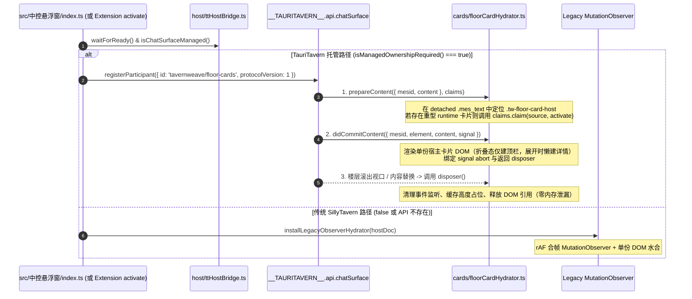

# 全域作战指挥系统 × TauriTavern 宿主适配与专属开发脚手架总方案

> **文档编号**：GHQ-TT-ARCH-2026-00 · 跨宿主双栖演进与开发工具链总纲  
> **状态**：总设计案已落盘（`proposed` · 待驾驶员审阅冻结） ｜ **日期**：2026-10-19  
> **适用范围**：`mvu指挥系统/src/中控悬浮窗/**`、`mvu指挥系统/src/红警指挥系统/**`、`mvu指挥系统/src/开场启动器/**`、`worldbooks/**` 及新增 TT 专属开发工具链 `scripts/tt-*`  
> **外部目标宿主真源**：[`Darkatse/TauriTavern`](https://github.com/Darkatse/TauriTavern)（`dev` 分支 v2.3.0+，Rust/Tauri v2 后端 + 上游 SillyTavern 1.18.0 前端 + `window.__TAURITAVERN__` 平台 ABI v1）  
> **配套实施任务包**：[`docs/Architecture/Future Developments/30-TauriTavern宿主适配与专属开发脚手架实施任务包.md`](../Future%20Developments/30-TauriTavern宿主适配与专属开发脚手架实施任务包.md)

---

## 〇、A0 工程检查单三门冻结与总体战略定位

### 1. A0 三门冻结（Goal / Red Lines / Acceptance）

- **目标（Goal）**：
  在不分叉（No-Fork）现有仓库、保持 30 卷世界书（`worldbooks/`）与底层确定性引擎（`src/红警指挥系统/{core,engines,parse,planning}`）单一事实源（SSOT）的前提下，构建一套 **「TauriTavern 专属三层开发脚手架（TT-DevKit）+ 双宿主自适应桥接层（`HostBridge`）+ 虚拟列表卡片水合（`ChatSurface`）+ 多端安全区/软键盘几何契约（`Layout`）+ 原生 Agent 参谋部与 `.ttskill` 技能包赋能」** 的完整适配体系。使红警全域指挥系统既能继续在传统 SillyTavern（Tavern Helper 脚本模式）运行，又能作为 **TauriTavern 原生第三方前端扩展（`third-party/tavernweave-command-system`）** 在 Windows / macOS / Linux / Android / iOS 全平台满血运行。
- **红线（Red Lines）**：
  1. **严禁破坏单一事实源与双端兼容性**：禁止为适配 TauriTavern 而复制第二套 `core/`、`engines/`、`parse/` 或 `models/` 业务代码；所有宿主差异必须收口于 `src/中控悬浮窗/host/` 与 `src/中控悬浮窗/cards/` 的桥接适配器内。
  2. **严禁改变存档 Schema 与世界书条令契约**：`stat_data`、`$boot`、`$parse`、`$timeline`、`$dlc` 的数据结构及 30 卷世界书 `<数据>` 块格式保持 100% 兼容，支持存档在传统 SillyTavern 与 TauriTavern 之间无损导入导出。
  3. **严禁在 `ChatSurface` 托管模式下双轨抢跑**：当 `window.__TAURITAVERN__?.api?.chatSurface?.isManagedOwnershipRequired?.() === true` 时，严禁启动传统 `MutationObserver` 全文档扫楼，防止虚拟滚动期间产生幽灵监听器与重复 DOM 挂载。
  4. **严禁绕过中控台只读守卫与受控写入白名单**：接入 `api.extensionStore`、`api.agent` 与 `api.worldInfo` 后，UI 面板对游戏核心状态（`stat_data`）的写操作仍必须严格走 `floorVarWrite.ts` 白名单或受控入档/解析管线。
- **验收（Acceptance）**：
  1. **脚手架门（Phase 0）**：浏览器级 `__TAURITAVERN__` 契约模拟器支持一键触发「虚拟列表楼层卸载/重挂」与「Android 软键盘/刘海屏安全区」压测；构建脚本可一键产出标准 `third-party/tavernweave-command-system` 扩展目录并支持通过 `tauri-pilot` 连接本地 `tauri:dev:pilot` 实例执行 `ping / snapshot / eval / logs`。
  2. **核心适配门（Phase 1）**：`floorCardHydrator.ts` 完整实现 `ChatSurfaceParticipantV1`（`prepareContent` / `didCommitContent` / `claims.claim` / `dispose`），千层聊天虚拟滚动下卡片零丢失、零内存泄漏；`shell.ts`、`modalHost.ts`、`TacticalPdaHost.vue` 完整接入 `data-tt-mobile-surface` 与 `api.layout`。
  3. **自动化测试与构建门**：`pnpm test`（Vitest 全量单测 + 新增 TT 契约单测）与双目标构建（传统 ST 脚本产物 + TT 原生扩展产物）100% 零报错通过。
  4. **真机与驾驶员验收门（Driver Acceptance）**：在本地 `TauriTavern (dev)` 宿主中通过 `tauri-pilot` 自动化巡检与驾驶员目视验收。

---

## 一、宿主环境深度对比：传统 SillyTavern vs TauriTavern

TauriTavern 将 SillyTavern 后端从 Node.js 完全重构为 Rust（Tauri v2 Clean Architecture Workspace：`tauritavern`、`tt-application`、`tt-ports`、`tt-domain`、`tt-contracts`、`tt-adapter-*`），前端保留上游 SillyTavern 1.18.0 并注入模块化 Tauri 宿主内核（`src/tauri/main/`），通过统一出口 **`window.__TAURITAVERN__`**（`abiVersion: 1`）对外暴露稳定契约。

### 1.1 核心运行机制与工程边界对照表

| 架构维度 | 传统 SillyTavern (+ Tavern Helper) | TauriTavern (`dev` v2.3.0+ 原生宿主) | 对本项目的工程影响与适配定性 |
| :--- | :--- | :--- | :--- |
| **宿主运行时与视图容器** | 浏览器 Tab（Chromium / Firefox / Safari） | 系统原生 WebView（Windows WebView2 / macOS WKWebView / Android & iOS WebView） | **调试工具链变革**：外部浏览器插件/Playwright 无法直连，需引入 **`tauri-pilot`** + 浏览器级 Mock 沙盒双轨调试 |
| **构建与前端加载器** | Node.js Express 静态服务 + Tavern Helper 注入 `TH-script--*` 隐藏 iframe | Rspack 构建 + Rust `on_web_resource_request` 协议层直供 `/scripts/extensions/third-party/*` | **分发形态升级**：除兼容 TH 脚本外，可打包为原生 `third-party` 扩展，享内置 Git（`gitoxide`）安装/更新/切分支 |
| **聊天楼层 DOM 生命周期** | 全量常驻 DOM（`#chat > .mes` 随楼层无限累加） | **`@tanstack/virtual-core` 虚拟列表投影** + **`ChatSurface API`** 生命周期交接 | **★ 最高优先级必改项**：滚出视口即销毁 `.mes` DOM，滚回重建且不发旧渲染事件；`floorCardHydrator` 必须接入 `ChatSurface` |
| **多端视口、安全区与软键盘** | 依赖浏览器裸 `window.innerWidth/Height`，移动端软键盘行为分裂 | **`Layout API` (`api.layout`)** + `data-tt-mobile-surface` 准入 + `--tt-inset-*` / `--tt-ime-bottom` | **★ 核心体验必改项**：`shell.ts`、`modalHost.ts`、`TacticalPdaHost` 需标记 surface 类型并订阅 `layout.subscribe` |
| **扩展本地结构化持久化** | 依赖浏览器 `localStorage`（换端口/清缓存易丢失，容量受限） | **`Extension Store API` (`api.extensionStore`)**：按 `namespace / table / key` 落盘本地 JSON 与二进制 Blob | **可靠性跃升**：指挥官设置、`$boot` 镜像、DLC 包缓存、解析指纹可落盘至 `_tauritavern/extension-store/` 并随 TT-Sync 同步 |
| **世界书激活观测与跳转** | 依赖监听内部事件或硬查 `#WorldInfo` / `#world_editor_select` 私有 DOM | **`WorldInfo API` (`api.worldInfo`)**：`getLastActivation()`、`subscribeActivations()`、`openEntry({ world, uid })` | **解耦私有 DOM**：图鉴词条跳转与本轮激活条令监控可直接走宿主公开契约 |
| **后台参谋与多步 AI 推演** | 只能借用主聊天通道或 `GENERATE_AFTER_COMMANDS` 塞入单次 Prompt | **`Agent API` (`api.agent`) + `Agent Tools`**：独立 Rust Agent Runtime、受控 Workspace、SubAgent 委派、`dice.roll` | **★ 战略玩法赋能**：排产沙盒、科研参谋、情报归档、战损检定可转入后台 Agent Run，零工具楼层污染 |
| **大型规则与条令按需检索** | 只能放入世界书（常驻耗 Token 或靠关键词被动触发） | **`Skill API` (`api.skill` / `.ttskill`)**：支持安装/读取本地 Skill，Agent 按需调用 `skill.list/search/read` | **★ Token 预算解放**：可将文风规范、核算条例与扩展图鉴封装为 `.ttskill` 供参谋 Agent 按需查阅 |

---

## 二、总体适配架构：四层同源双栖体系（Dual-Host Architecture）

为遵守 A0「最少文件变更、最少新增抽象层、严禁分叉业务底座」原则，我们在现有 **「`src/中控悬浮窗`（7 大子目录）+ `src/红警指挥系统`（同源领域引擎）」** 架构之上，采用 **四层同源双栖拓扑**：

```
┌────────────────────────────────────────────────────────────────────────────────────────┐
│                       全域作战指挥系统 · 双宿主自适应总架构                             │
└───────────────────────────────────────────┬────────────────────────────────────────────┘
                                            │
        ┌───────────────────────────────────┼───────────────────────────────────┐
        ▼                                   ▼                                   ▼
┌───────────────────────────────┐   ┌───────────────────────────────┐   ┌───────────────────────────────┐
│   L0 · 100% 零改动共享真源层   │   │   L1 · 双宿主自适应桥接网关层  │   │  L2 · TauriTavern 原生赋能层   │
│  (worldbooks + 红警核心引擎)   │   │ (host/ttHostBridge + Cards)   │   │  (Agent 参谋部 + .ttskill)    │
├───────────────────────────────┤   ├───────────────────────────────┤   ├───────────────────────────────┤
│ · 30 卷世界书 JSON 与 <数据>  │   │ · ttHostBridge.ts:            │   │ · ttAgentDirector.ts:         │
│ · core/ (Schema V2, Catalog)  │   │   统一探测 __TAURITAVERN__    │   │   对接 api.agent 后台推演     │
│ · engines/ (UTO/五大结算引擎) │   │ · Layout 几何契约:            │   │   (科研顾问/排产沙盒/自动摘要) │
│ · parse/ (L0-L3 & R1-R27)     │   │   data-tt-mobile-surface      │   │ · ttSkillBundle.ts:           │
│ · planning/ (排产/顾问纯算法) │   │   + layout.subscribe 安全区   │   │   对接 api.skill 管理战区条令 │
│ · models/ (22 个纯视图模型)   │   │ · ChatSurface 双轨水合:       │   │   (.ttskill 按需检索零常驻)   │
│ · console/modals/panels/pda   │   │   Participant V1 虚拟列表托管 │   │ · WorldInfo 激活监控与直跳    │
│   (Vue 3 业务组件层)          │   │ · ExtensionStore 持久化网关   │   │                               │
└───────────────────────────────┘   └───────────────┬───────────────┘   └───────────────┬───────────────┘
                                                    │                                   │
                                                    ▼                                   ▼
                                    ┌───────────────────────────────────────────────────────────┐
                                    │        L3 · TT-DevKit 三层专属开发与真机验收脚手架         │
                                    ├───────────────────────────────────────────────────────────┤
                                    │ ① 浏览器级 TT Host Simulator (Vite HMR + 虚拟滚动/IME模拟) │
                                    │ ② 双栖打包与 Junction 热投送器 (scripts/tt-ext-sync.mjs)   │
                                    │ ③ Tauri Pilot 真机自动化驾驶舱 (scripts/tt-pilot-cli.mjs) │
                                    └───────────────────────────────────────────────────────────┘
```

### 2.1 前端承载面适配契约（Frontend Fit Contract）

```yaml
recommended: hybrid
fit: suitable
reason: 指挥系统由「右侧常驻主控台 (console) + 八大全屏战术弹窗 (modals) + 战地手持板 (pda) + 聊天楼层水合卡片 (cards)」组成混合承载面。在 TauriTavern 下通过 ChatSurface API 接管楼层卡片随虚拟滚动的挂载/销毁，通过 Layout API 统一桌面与移动端安全区/软键盘避让，既保持完整红警指挥台体验，又完美契合 TauriTavern 虚拟 DOM 性能模型。
fallback: lightweight-display（当运行于受限 WebView 或未授予重型 runtime grant 时，ChatSurface 自动降级为零 iframe 的纯 DOM 摘要卡片，主控台保持 36px 窄边折叠按需展开）
reopenWhen: TauriTavern 未来开放原生多窗口（Multi-Webview）API 或独立桌面副屏契约时，可评估将八大战术弹窗拆分为独立副屏战术监视器。
driverOverride: false
```

### 2.2 存量资产复用账本（Legacy Reuse Ledger）

| 资产模块与路径 | 决策 | 既有稳定证据 | 在 TauriTavern 架构中的职责 | 迁移风险与重验门禁 |
| :--- | :---: | :--- | :--- | :--- |
| `worldbooks/*.json`（30 卷世界书） | **复用** | `校验世界书.mjs` 0 error，常驻 13 条预算锁定 | 原样作为战区科技/建筑/武备/条令唯一数据真源 | 在 TT 真机验证世界书加载与 `api.worldInfo.getLastActivation` |
| `mvu指挥系统/src/红警指挥系统/{core,engines,parse,planning}/` | **复用** | 176 个测试文件、2945 项断言 PASS | 双宿主 100% 共享的纯函数状态机与解析底座 | 零改动；保持 Vitest 全量单测门禁 |
| `mvu指挥系统/src/中控悬浮窗/models/`（22 模块） | **复用** | 纯函数视图投影，无 DOM 耦合 | 继续为侧边栏、八大弹窗、PDA 提供视图模型 | 结合《任务包 29》完成 $O(N)$ 索引优化 |
| `mvu指挥系统/src/中控悬浮窗/cards/floorCardHydrator.ts` | **改造** | 12 类卡片解析与 DOM 渲染器已完备 | 抽离双轨驱动：`ChatSurfaceParticipantV1`（TT 托管）+ 单份 DOM `MutationObserver`（传统 ST 回退） | 重点验证虚拟列表上下高速滚动时的幂等挂载与 disposer 释放 |
| `mvu指挥系统/src/中控悬浮窗/host/{shell,modalHost}.ts` | **改造** | `ShellDeps` 已具备视口与存储依赖注入抽象 | 注入 `data-tt-mobile-surface` 属性；对接 `api.layout` 安全区与 IME 软键盘偏移；对接 `api.extensionStore` | 桌面端窗口缩放 + 移动端刘海屏/软键盘弹出模拟测试 |
| `mvu指挥系统/src/中控悬浮窗/host/{advisoryRunner,scheduleRunner,summaryRunner}.ts` | **改造** | 现有 Prompt 前馈注入与摘要生成逻辑成熟 | 新增 `ttAgentDirector.ts` 分支：在 TT 环境下可选调用 `api.agent.startRunFromLegacyGenerate` 后台执行 | 验证 dryRun 快照捕获、Workspace 产物读取与失败回退传统路径 |
| 本地 Node 辅助脚本（`世界书同步服务.mjs` / `起服CORS.mjs`） | **仅参考** | 传统 ST 本地开发热同步工具 | TT 原生具备 `/scripts/extensions/third-party/*` 协议端点，改为 `scripts/tt-ext-sync.mjs` 本地目录联接 | 验证 `/scripts/extensions/third-party/tavernweave-command-system/` 静态加载 |

---

## 三、先建工具再动工：TT 专属三层开发脚手架（Phase 0 · TT-DevKit）

### 3.1 为什么必须建设专门的 TT 脚手架与 Rust 调试底座？

1. **Tauri 原生 WebView 的调试壁垒**：
   TauriTavern 运行于操作系统原生 WebView（Windows 下为 WebView2），而非普通 Chrome 浏览器标签页。要让 AI Agent 与自动化测试脚本实时检查 DOM、点击按钮、执行 JS 与读取日志，必须借助 [`mpiton/tauri-pilot`](https://github.com/mpiton/tauri-pilot)。
2. **`tauri-plugin-pilot` 的编译期安全门禁**：
   TauriTavern 正式发行包默认不编译调试插件。只有从 `Darkatse/TauriTavern` 的 **`dev` 分支（v2.3.0+）** 源码执行：
   ```bash
   pnpm run tauri:dev:pilot
   # 底层命令：node scripts/tauri-app.mjs --prepare-frontend dev --features devtools-pilot
   ```
   开启 Rust `--features devtools-pilot` 特性并激活 `pilot:default` 权限后，宿主才会启动本地命名管道（Named Pipe / Unix Socket）供 `tauri-pilot` CLI 连接。
3. **我们自身业务代码零 Rust 负担**：
   本项目的业务代码（`mvu指挥系统`）仍然是 **100% TypeScript + Vue 3**。本机安装 Rust（`rustup` stable, edition 2024）仅用于：
   - 一次性编译安装 `cargo install tauri-pilot-cli`；
   - 本地启动一次 `TauriTavern` 的 `tauri:dev:pilot` 调试宿主（后续改我们自己的前端代码无需重编 Rust）。

### 3.2 三层脚手架架构设计（`TT-DevKit`）

#### 第 1 层：浏览器级 `window.__TAURITAVERN__` 契约模拟器（`src/中控悬浮窗/host/ttHostSimulator.ts`）
为了让日常 90% 的 UI 与逻辑开发继续享受 Vite 毫秒级 HMR（且可在无 Rust 环境下独立跑通全部单测与浏览器预览），在开发态与测试态提供高保真宿主模拟器：
- **虚拟列表生命周期模拟（`ChatSurface Simulator`）**：
  - 模拟 `isManagedOwnershipRequired() === true` 與 `registerParticipant()`；
  - 提供调试动作 `simulateVirtualScrollUnmount(mesIds[])` 与 `simulateVirtualScrollRemount(mesIds[])`：强制从 DOM 移除指定楼层 `.mes` 节点、触发 `AbortSignal` 与 participant `disposer`，随后从内存 `chat[]` 重新创建全新 `.mes_text` 并再次走 `prepareContent -> didMount -> didCommitContent -> grant activate`，专门用于在浏览器和 Vitest 中拷打楼层卡片水合器是否泄漏或丢卡！
- **多端几何与软键盘模拟（`Layout Simulator`）**：
  - 模拟 `api.layout.snapshot()` 与 `api.layout.subscribe()`；
  - 支持一键切换预设工况：`Desktop (1920×1080)`、`Mobile Notch (390×844, top: 47px, bottom: 34px)`、`Android IME Open (keyboardOffset: 320px, --tt-ime-bottom: 320px)`，实时检验 `shell.ts` 钳位与 `modalHost.ts` 弹窗避让。
- **持久化与 Agent 模拟（`ExtensionStore & Agent Simulator`）**：
  - 基于内存 `Map` + `localStorage` 镜像模拟 `api.extensionStore.{getJson,tryGetJson,setJson,updateJson,deleteJson,listKeys,getBlob,setBlob}`；
  - 模拟 `api.agent.startRunFromLegacyGenerate` 事件流（`run_created` $\rightarrow$ `tool_call_requested` $\rightarrow$ `workspace_file_written` $\rightarrow$ `run_completed`）。

#### 第 2 层：双栖打包与一键热投送脚手架（`scripts/tt-ext-sync.mjs`）
在 `mvu指挥系统` 中新增 TauriTavern 原生第三方扩展构建模式，做到**一套源码、双端产物**：
- **双栖入口与 Manifest 生成**：
  - 保持现有 `dist/中控悬浮窗/index.js`（供传统 SillyTavern + Tavern Helper 加载）；
  - 新增 `dist/tauritavern-extension/` 输出目录，自动生成符合 TauriTavern 规范的 `manifest.json`：
    ```json
    {
      "display_name": "全域作战指挥系统 (TavernWeave Command)",
      "loading_order": 50,
      "js": "index.js",
      "css": "style.css",
      "author": "GHQ-ST-Engineering",
      "version": "2.0.0",
      "minimum_client_version": "SillyTavern::TauriTavern",
      "hooks": {
        "activate": "activate"
      }
    }
    ```
- **Windows 目录联接（Junction）与 Watch 热投送**：
  - `node scripts/tt-ext-sync.mjs --link --tt-root <path-to-TauriTavern>`：自动将 `dist/tauritavern-extension` 挂载（Junction 软链或增量复制）至 TauriTavern 用户数据目录下的 `extensions/third-party/tavernweave-command-system/`；
  - 配合 `pnpm build --watch`，前端改码后 1 秒内落盘，无需重启 Tauri 宿主进程。

#### 第 3 层：`tauri-pilot` 自动化真机驾驶舱（`scripts/tt-pilot-runner.mjs`）
封装 `tauri-pilot` CLI，为开发者与 AI Agent 提供标准化的真机诊断与自动化验收指令集：
- `node scripts/tt-pilot-runner.mjs doctor`：检查本机 `rustc`、`cargo`、`tauri-pilot`、`<path-to-TauriTavern>` 分支状态及 `tauri-pilot ping` 连通性；
- `node scripts/tt-pilot-runner.mjs reload`：通过 `tauri-pilot eval "location.reload()"` 触发 TauriTavern WebView 秒级热刷新并等待 `window.__TAURITAVERN_MAIN_READY__`；
- `node scripts/tt-pilot-runner.mjs smoke`：自动执行真机冒烟断言：
  1. 校验 `window.__TAURITAVERN__.abiVersion === 1`；
  2. 校验中控悬浮窗根容器、`#tavernweave-tactical-modal-overlay`、`#tavernweave-hud-host` 的 `data-tt-mobile-surface` 属性；
  3. 抓取 `tauri-pilot snapshot -i` 可访问性树与 `tauri-pilot logs --level error`，输出结构化验收回执。

---

## 四、四大核心业务域适配详设（Phase 1 & Phase 2）

### 4.1 宿主桥接网关（`src/中控悬浮窗/host/ttHostBridge.ts`）

在 `host/` 层建立唯一的 TauriTavern 能力探测与调用收口模块 `ttHostBridge.ts`，向上游模块屏蔽 `window.__TAURITAVERN__` 与 `window.parent.__TAURITAVERN__` 的跨帧寻址细节：

```ts
export interface TauriTavernBridge {
  /** 当前是否运行在 TauriTavern 宿主环境 */
  readonly isTauriTavern: boolean;
  /** 等待 __TAURITAVERN__.ready / __TAURITAVERN_MAIN_READY__ 就绪 */
  waitForReady(): Promise<boolean>;
  /** ChatSurface 虚拟列表托管是否启用 */
  isChatSurfaceManaged(): boolean;
  /** 获取原生 API 命名空间（若不可用则返回 null） */
  readonly layout: TauriTavernLayoutApi | null;
  readonly chatSurface: TauriTavernChatSurfaceApi | null;
  readonly extensionStore: TauriTavernExtensionStoreApi | null;
  readonly worldInfo: TauriTavernWorldInfoApi | null;
  readonly agent: TauriTavernAgentApi | null;
  readonly skill: TauriTavernSkillApi | null;
}
```

- **跨帧穿透寻址**：无论当前代码运行在 TauriTavern 主文档（作为原生 `third-party` 扩展）还是运行在 Tavern Helper 的 `TH-script--*` 同源子 iframe 内，`ttHostBridge` 均通过 `resolveHostWindow()` 向上查找 `window.__TAURITAVERN__`，确保两种加载形态下 API 100% 一致可用。
- **双栖存储网关（`ttStorageAdapter.ts`）**：
  - 为 `shell.ts`（悬浮窗几何状态）、`pdaState.ts`（PDA 状态）、`patchFailFingerprint.ts`（补丁失败指纹）与 DLC 缓存提供统一异步/同步带缓存的存储接口：
  - 在 TauriTavern 下自动异步双写至 `api.extensionStore`（`namespace: 'tavernweave-command'`，分表 `ui-state` / `fingerprints` / `dlc-cache`），并在启动时从 `extensionStore` 预热回填内存与 `localStorage`，兼顾同步读取速度与跨设备 `TT-Sync` 落盘持久性。

### 4.2 聊天虚拟列表与楼层卡片水合适配（`cards/floorCardHydrator.ts` + `ChatSurface API`）

结合《任务包 29（性能治理）》的「废除 `mountBoth` 双份隐藏 iframe + 折叠态主体懒创建」，将 `floorCardHydrator.ts` 重构为 **「纯卡片 DOM 构建器 + 双轨生命周期驱动器」**：



- **解决虚拟列表重挂丢失问题**：
  在 TauriTavern 中，当用户向上滚动几百楼再滚回底部时，宿主会从 `chat[]` 重新创建全新的 `.mes_text` DOM，并自动回调 `prepareContent` 与 `didCommitContent`。由于不再依赖只在初次生成时触发的 `CHARACTER_MESSAGE_RENDERED` 事件，无论怎么来回滚动几千层，`<阵营解锁>`、`<机娘档案>`、`<航天合同>`、`<事件>`、`<排产计划>` 等 12 类卡片都能瞬间精准复现！
- **禁止全表 DOM 扫描**：
  全面排查并禁止使用 `document.querySelectorAll('#chat > .mes')` 计算楼层总数；所有楼层数据扫描继续严格通过 `chat[]` / `getChatMessages` / `getLastMessageId` 数据层接口完成。

### 4.3 多端安全区、视口与软键盘几何契约（`host/shell.ts` + `host/modalHost.ts` + `Layout API`）

针对 TauriTavern 跨桌面（Windows/macOS/Linux）与移动（Android/iOS）的全平台特性，全面接入 `window.__TAURITAVERN__.api.layout` 与硬 ABI 属性：

1. **显式声明 `data-tt-mobile-surface` 分类标签**：
   | 宿主容器 / 组件 | DOM 节点标识 | 声明属性值 | TauriTavern 宿主几何行为 |
   | :--- | :--- | :--- | :--- |
   | 全屏模态框背景遮罩 | `#tavernweave-tactical-modal-overlay` 背景层 | `data-tt-mobile-surface="backdrop"` | Full-bleed 全屏铺满，不收四边 safe-area |
   | 八大全屏战术弹窗主体 | `.tw-modal-window` / 模态框根容器 | `data-tt-mobile-surface="fullscreen-window"` | 自动注入四边 safe-area 与 Android 键盘 `--tt-viewport-bottom-inset` |
   | 侧边主控台悬浮壳 | `shell.ts` 宿主容器 / 浮窗根 | `data-tt-mobile-surface="free-window"` | 允许自由拖拽与贴边折叠，不被宿主兜底分类器强制裁切 |
   | 战地手持板 PDA 与信标 | `#tavernweave-hud-host` 内 `.pda-window` / `.pda-beacon` | `data-tt-mobile-surface="free-window"` | 自由悬浮于安全区 frame 内，支持拖拽与边缘吸附 |
   | 同源伴生 Iframe（若启用） | 内部同源 iframe 节点 | `data-tt-mobile-surface="viewport-host"` | 通过 `mobile-iframe-viewport-contract-bridge` 同步 `--tt-*` 变量 |

2. **`shell.ts` 接入 `api.layout.subscribe` 动态安全框（`safeFrame`）**：
   - 在 `shell.ts` 中扩展 `Viewport` 结构，支持可选 `safeInsets: { top, right, bottom, left }` 与 `keyboardOffset: number`；
   - 当运行于 TauriTavern 时，`shell.ts` 通过 `layout.subscribe(snap => ...)` 实时获取 `snap.safeFrame`（已扣除刘海屏、状态栏与底部导航条的可用视口区域），将左右贴边停靠（`dockToRight` / `dockToLeft`）与自由拖拽钳位（`clampPosition`）严格限制在 `safeFrame` 内；
   - 当 Android 软键盘弹起（`snap.ime.keyboardOffset > 0`）且焦点位于弹窗或设置输入框时，自动利用 `--tt-viewport-bottom-inset` 上推底部操作栏，彻底告别移动端输入被键盘遮挡的顽疾。

### 4.4 战区总参谋部原生 Agent 化与 `.ttskill` 技能包（`host/ttAgentDirector.ts` & `host/ttSkillBundle.ts`）

充分利用 TauriTavern 独有的 Rust Agent Runtime（`api.agent`）与 Skill 管理接口（`api.skill`），为指挥系统开辟第二代 AI 驱动引擎：

1. **后台参谋部 Agent 编排器（`ttAgentDirector.ts`）**：
   - **预设参谋 Profile（`ghq-tactical-staff`）**：通过 `api.agent.profiles.save()` 注册受控参谋 Profile（工作区可见根目录 `output`、`scratch`、`plan`、`summaries`、`persist`；允许工具：`worldinfo.read_activated`、`chat.read_messages`、`chat.search`、`skill.list`、`skill.read`、`workspace.read_file`、`workspace.write_file`、`workspace.apply_patch`、`dice.roll`、`agent.delegate`、`agent.await`、`workspace.finish`）。
   - **四大赋能场景**：
     - **场景 A · 后台战局自动摘要（升级 `summaryRunner.ts`）**：在后台（`presentation: 'background'`）启动 Agent Run，读取最近 N 楼战报与激活世界书，在 `summaries/` 下生成结构化战局简报，零主对话卡顿；
     - **场景 B · 参谋排产沙盒与科研顾问（升级 `PlanningSandbox` & `advisoryRunner`）**：参谋 Agent 调用 `worldinfo.read_activated` 读取当前已解锁的苏/盟/尤里科技与建筑 `<数据>` 块，在 `plan/option_a.json` 与 `plan/option_b.json` 中输出两套排产方案，中控台通过 `api.agent.readWorkspaceFile()` 直接读取渲染进 `PanelPlanningCard.vue`；
     - **场景 C · 真实随机检定（`dice.roll`）**：在暗网竞拍、高危协议实验、次生机娘涌现与恶劣天气灾变中，由 Agent 调用原生 `dice.roll` 工具产生可审计的确定性随机种子与检定记录；
     - **场景 D · 多席位 SubAgent 协同（`agent.delegate` + `agent.await`）**：总参谋长 Agent 可将「六大战略资源收支精算」、「新登场机娘档案草拟」分别委派给专项 SubAgent 并行处理后汇总。
2. **战区条令 `.ttskill` 技能包管理器（`ttSkillBundle.ts`）**：
   - 将《世界书文风与受控质感编写规范》、R1–R27 体检修复手册、动态词条编写模板打包为内置 `.ttskill` 载荷（带 `source: 'extension:tavernweave-command-system'`）；
   - 通过 `api.skill.installImport({ input, conflictStrategy: 'replace' })` 按需安装；参谋 Agent 在生成 `<扩展档案>` 或 `<机娘档案>` 时通过 `skill.read` 按需调阅，**平时占 0 个聊天 Prompt Token**！

---

## 五、分阶段演进路线图与四态决策账本

### 5.1 演进阶段划分（Phased Roadmap）

- **Phase 0 · 脚手架与环境先行（TT-DevKit Bootstrap）**：
  落地浏览器级 `ttHostSimulator.ts`、双栖扩展构建出口 `manifest.json`、热投送脚本 `scripts/tt-ext-sync.mjs` 与 `tauri-pilot` 自动化巡检脚本 `scripts/tt-pilot-runner.mjs`；配齐本机 Rust + `tauri-pilot-cli` + `TauriTavern (dev)` 调试底座。
- **Phase 1 · 核心宿主适配与性能治理合流（First Playable）**：
  落地 `ttHostBridge.ts`、`ttStorageAdapter.ts`（对接 `extensionStore` & `worldInfo`）、`floorCardHydrator.ts`（对接 `ChatSurface Participant V1` + 砍除双份隐藏 iframe）、`shell.ts` & `modalHost.ts`（对接 `Layout API` & `data-tt-mobile-surface`），并与《任务包 29（性能治理）》合流验收。
- **Phase 2 · 原生参谋部 Agent 与 `.ttskill` 赋能（Strategic Growth）**：
  落地 `ttAgentDirector.ts` 与 `ttSkillBundle.ts`，打通后台参谋推演、Workspace 方案读取、`dice.roll` 战术检定与 `.ttskill` 条令按需检索。

### 5.2 四态决策账本（Four-State Decision Ledger）

| 决策 ID | 状态 | 决策内容与工程边界 |
| :--- | :---: | :--- |
| **`C-TT-01`** | `confirmed` | **立项与文档先行**：在 `docs/Architecture/TaruiTavern/` 建立适配总方案，并在 `docs/Architecture/Future Developments/` 建立正交实施任务包（30 号包）。 |
| **`C-TT-02`** | `confirmed` | **脚手架先行原则（Phase 0）**：开工改写业务代码前，先建设面向 TauriTavern 的专属开发工具链（含浏览器契约模拟器、扩展打包热投送器、`tauri-pilot` 自动化巡检器）。 |
| **`P-TT-01`** | `proposed` | **双栖同源分发（对应 D-TT-01 = A）**：保留 Tavern Helper 脚本构建产物，同时新增 TauriTavern 原生 `third-party/tavernweave-command-system` 扩展构建出口，共用同一套 `src/` 源码。 |
| **`P-TT-02`** | `proposed` | **与《任务包 29》合流攻坚（对应 D-TT-02 = A）**：在改造 `floorCardHydrator.ts` 与 `modalHost.ts` 时，同步完成「砍除双份隐藏 iframe、折叠态懒构建、Modal 外层 `v-if` 按需挂载」。 |
| **`P-TT-03`** | `proposed` | **Agent API 与 Skill API 分步接入（对应 D-TT-03 = A）**：Phase 1 先在 `ttHostBridge` 冻结接口并完成 `ttAgentDirector` / `ttSkillBundle` 底座封装与沙盒验证；Phase 2 全面接管后台科研/排产/摘要参谋。 |
| **`P-TT-04`** | `proposed` | **宿主环境分支锚定**：本地克隆 `Darkatse/TauriTavern` 时固定检出 **`dev` 分支（v2.3.0+）**，使用 `pnpm run tauri:dev:pilot` 启动带 `devtools-pilot` 特性的真机宿主。 |
| **`R-TT-01`** | `rejected` | **否决分叉仓库（Fork）维护两套业务逻辑**：维护两套 `core/engines/models` 会导致世界书与状态机迅速漂移，已明确否决。 |
| **`R-TT-02`** | `rejected` | **否决在 `ChatSurface` 托管模式下继续混跑全局 `MutationObserver`**：会导致虚拟列表滚动时双倍水合与监听器泄漏，已明确否决。 |

---

*系统映射：document=GHQ-TT-ARCH-2026-00 | targetHost=TauriTavern-v2.3-dev | abiVersion=1 | phases=Phase0_DevKit+Phase1_CoreBridge+Phase2_AgentSkill | companionTaskPack=FutureDevelopments/30*
